# 视觉—语言预训练方向论文阅读

# 一、Learning Transferable Visual Models From Natural Language Supervision(从自然语言监督中学习可迁移视觉模型)

## 一、研究背景与动机

传统计算机视觉模型通常依赖人工标注：

但是存在问题：

- 标注成本高：每换一个任务，就要重新标注、重新训练
- 类别固定：ImageNet 只有 1000 类，模型只学会区分这 1000 类
- 泛化能力差：模型难以处理训练时没见过的类别或任务

论文希望解决：能不能像 GPT 学习文本一样，让模型直接从互联网中的图像+文本学习视觉知识？

作者首先构建了一个：4亿图像文本对(image,text)数据集，利用自然语言监督训练视觉模型——clip。最终实现：不用 ImageNet 标签，也可以完成分类。

## 二、clip核心思想

CLIP让模型学习“图片和文字之间的对应关系”，而不是学习固定类别。

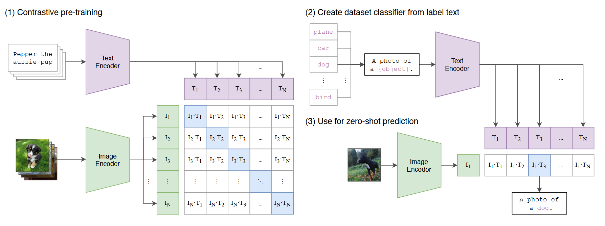

### 1、Contrastive pre-training——对比预训练

这一部分是 CLIP训练阶段。目标：让模型学会图片和文字之间的对应关系。

输入文本和图片分别得到文本特征和图片特征，图形文本相似度矩阵的对角线是正样本相似度。论文的训练目标就是拉近正样本拉远负样本

### 2、Create dataset classifier from label text——测试阶段准备分类器。

CLIP没有训练分类头。所以CLIP用类别名称生成分类器：先将类别标签加上一个相同的模板然后送入text encode生成特征表示。使用文本编码器生成了分类器

### 3、Use for zero-shot prediction——最终分类过程

输入一张新的图片得到图片特征然后和所有类别文本比较，然后进行最大相似度计算完成零样本分类

## 三、CLIP训练方法

### 1、 数据

作者建立：WIT数据集（WebImageText）包含4亿(image,text)

### 2、 两个编码器

1、 Image Encoder(图像编码器)
作用：把图片转换成向量。

论文中使用：

- ResNet
- Vision Transformer

2、Text Encoder(文本编码器)

作用：

把文字转换成向量。

然后比较图片向量和文字向量之间的距离。

### 3、 映射到同一个空间

图片特征和文本特征两个空间不一样，所以需要用两个可学习的线性投影矩阵映射到同一空间：

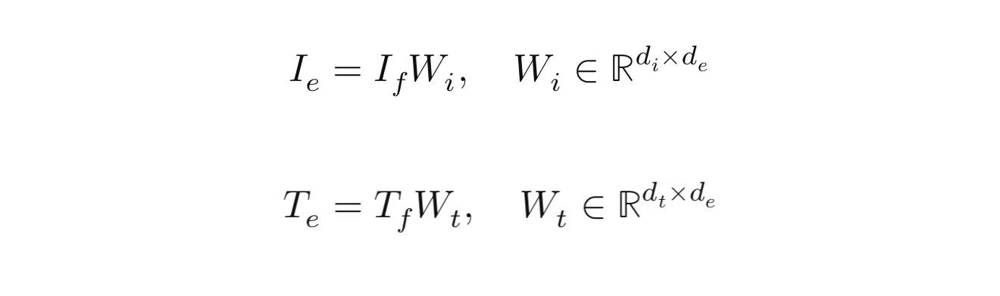

然后进行L2归一化

### 4、 计算相似度并训练

对一个 batch 的 N 对（图像，文本）进行矩阵乘法计算：

然后做对称交叉熵损失，让对角线上的正样本对相似度最大。 

## 四、CLIP的zero-shot分类

• 传统视觉模型每换一个任务就要重新标注、重新训练。
• CLIP 希望做到：预训练一次，之后用自然语言直接定义任务，无需微调。

  CLIP的zero-shot分类不是训练一个固定分类器，而是把类别名称转换成文本描述，通过Text Encoder生成类别特征，然后计算输入图片特征与各个类别文本特征的相似度，选择相似度最高的类别作为预测结果。因此，只要提供新的类别名称，就可以完成零样本分类。

## 五、实验部分

### 1、为什么选择对比学习

### 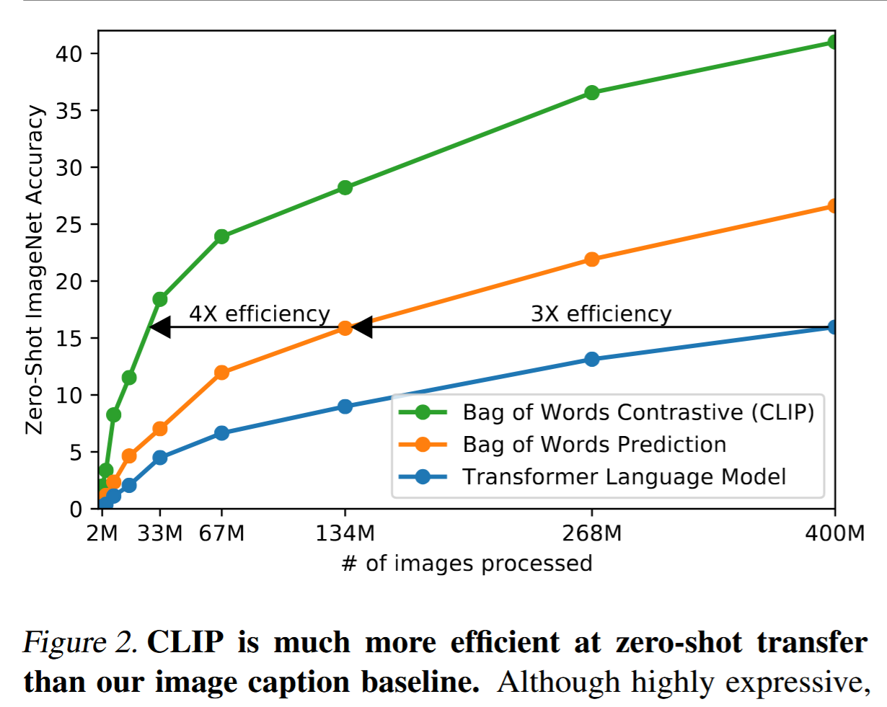

这张图比较三种训练目标：

1. Transformer Language Model：根据图片逐词生成文本；
2. Bag-of-Words Prediction：预测文本里有哪些词；
3. Bag-of-Words Contrastive，也就是 CLIP 的对比学习。

横轴是训练期间处理的图片数量，纵轴是 ImageNet zero-shot 准确率。它说明CLIP 并不是因为生成模型“不会理解图片”才放弃生成任务，而是因为：对于学习可迁移的视觉表示，“判断哪段文字与图片匹配”比“逐词还原原始文字”高效得多。

### 2、使用Prompt提升性能

### 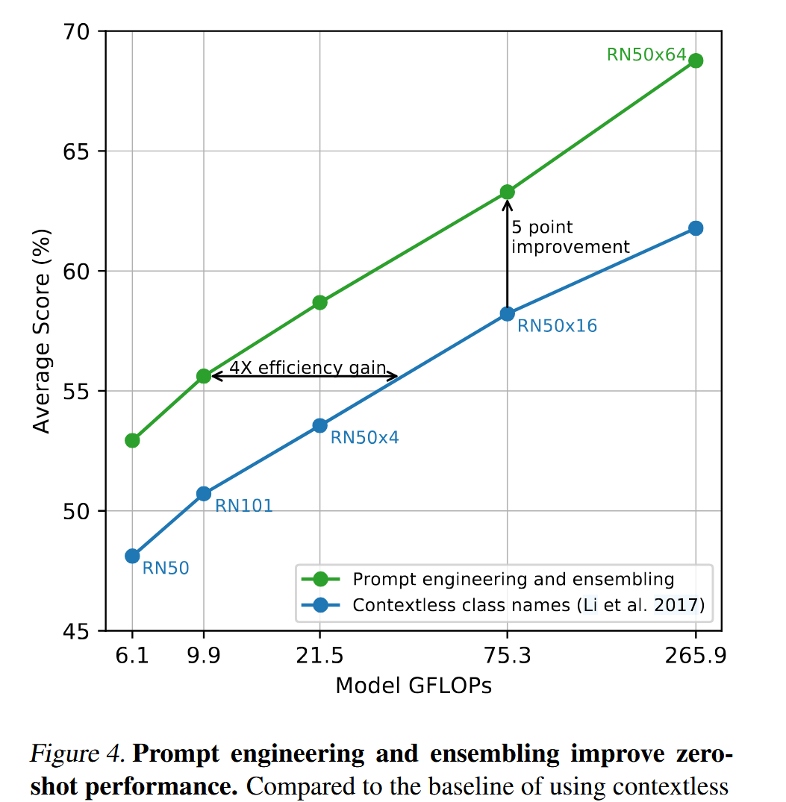

  CLIP 里的 prompt 就是把类别名称包装成自然语言句子（如 “A photo of a {label}.”），再喂给文本编码器做零样本分类。 合适的 prompt 能消除歧义、匹配预训练分布，甚至通过集成免费提升几个百分点。  

### 3、CLIP 更适合哪些任务

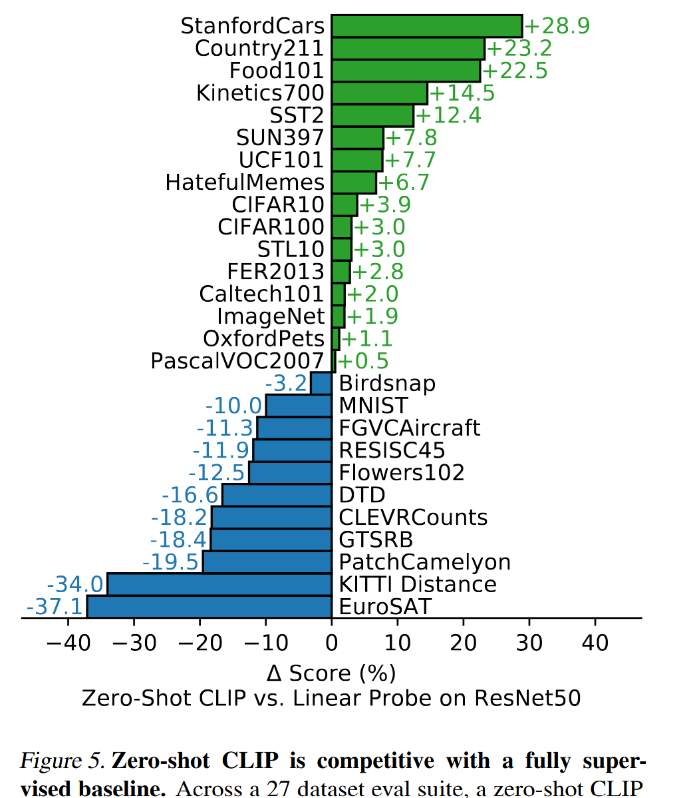

这张横向条形图比较：Zero-shot clip和ResNet-50 Linear Probe在27个图像数据集上的得分差距。

- 条形向右：CLIP 更好；
- 条形向左：监督基线更好。

CLIP 完全不使用下游数据集的训练样本，仅依靠类别文字，就能在 27 个数据集中的 16 个上超过使用标注数据训练线性分类器的 ResNet-50。说明CLIP 擅长训练数据中容易通过自然语言表达的概念，例如：物体类别、 食物、汽车型号、动作、地理概念。但对于精确计数、距离估计、 医学图像、 交通标志、卫星图像、与网页图文分布差异很大的任务相对较弱。所以说Zero-shot CLIP 已能与有监督的通用视觉基线竞争， 但能力明显取决于任务和数据分布。

## 六、总结

  这篇论文解决的核心问题是：如何摆脱计算机视觉模型对固定类别标注数据的依赖，让模型能够直接从互联网规模的原始文本中学习视觉概念，并具备强大的零样本迁移能力。 具体来说，传统视觉系统只能识别预先定义好的固定类别（如 ImageNet 的 1000 类），换一个任务就需要重新标注和训练；CLIP 通过对比学习，在 4 亿对互联网图文数据上联合训练图像编码器和文本编码器，把图像和自然语言映射到同一个嵌入空间，从而可以用自然语言动态定义任意分类任务，无需任何微调就能在新数据集上取得有竞争力的性能

CLIP 很擅长回答：这张图和这段文字整体上是否相似？

但不天然擅长：

- 生成 caption；
- 回答开放式问题；
- 建模主客体、数量、空间关系等细节；
- 让图像 token 和文本 token 深度交互。

因此 BLIP 引入两方面创新：

\[ \boxed{ \text{BLIP} = \text{MED 模型} + \text{CapFilt 数据自举} } \]

# 二、BLIP: Bootstrapping Language-Image Pre-training for Unified Vision-Language Understanding and Generation（Blip：引导式语言-图像预训练，统一视觉-语言理解与生成。）

## 一、研究背景与动机

  论文认为当时 VLP 有两个主要问题：编码器模型适合理解任务但不擅长生成，Encoder-Decoder 适合生成但不擅长检索；同时，大量网页 image-text 数据虽然规模大，但文本噪声严重。

## 二、核心思路

一方面设计一个既能“理解图文”又能“生成文字”的统一模型；另一方面用 Captioner + Filter 把互联网上噪声严重的图文数据“洗干净”

### 1、创新一：MED

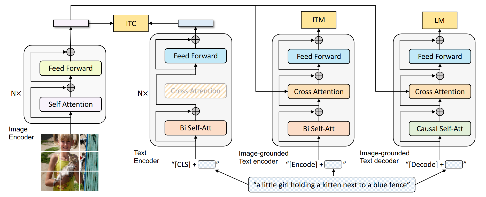

  这张图展示的是 BLIP 中 MED（Multimodal Mixture of Encoder-Decoder）模型的整体结构，它通过共享参数的 Transformer 设计，使模型同时具备图文理解和图像生成能力。首先，图像经过 Image Encoder 提取视觉特征；随后，根据不同任务，文本模块采用三种不同模式：第一种是 Text Encoder，利用双向 Self-Attention 编码文本，并通过 ITC（Image-Text Contrastive Learning） 学习图像和文本之间的整体语义对齐；第二种是 Image-grounded Text Encoder，在文本编码过程中加入 Cross Attention，使文本能够关注图像信息，通过 ITM（Image-Text Matching） 判断图像和文本是否匹配，从而学习更细粒度的视觉-语言关系；第三种是 Image-grounded Text Decoder，将双向注意力替换为 Causal Self-Attention，结合图像特征进行文本生成，通过 LM（Language Modeling） 学习根据图像生成描述。该结构通过 ITC、ITM 和 LM 三种训练目标，分别实现图文语义对齐、跨模态匹配以及视觉到语言的生成，使 BLIP 能够统一完成视觉理解和视觉生成任务。

-  ITC（图文对比学习） 学的是：图像整体语义和文本整体语义是否接近。

-  ITM（图文匹配）中出现了一个很重要的结构：Cross Attention  所以文本 token 在处理自己的同时，可以主动“查看图像”。它负责图像和文字细节是不是真的匹配

所以ITC 学粗粒度语义对齐；而ITM 学细粒度图文交互。

- LM（图像描述生成）：训练目标就是负责看图之后怎么生成自然语言。

整个思路就是：

\[ \boxed{ 粗粒度对齐 \rightarrow 细粒度融合 \rightarrow 语言生成 } \]

### 2、创新二：CapFilt

因为互联网的数据多但并不意味着数据质量好，很多时候文本可能和网页有关但却没有描述图像的内容如果把大量这样的数据直接喂给模型，模型会得到大量错误监督信号。因此作者提出：CapFilt

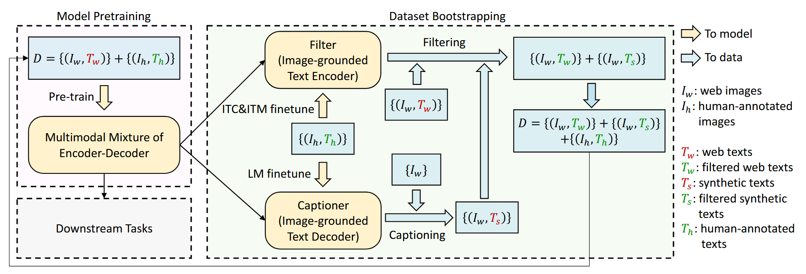

Captioner 负责给网页图片重新生成 caption；Filter 则判断原始文本和生成文本是否真正与图片匹配，最后使用过滤后的数据重新训练模型。
Filter：提高质量。把：错误、不相关、噪声 caption删除。
Captioner：增加信息和多样性。它不仅是在清洗已有数据，还能创造新的描述方式。

## 三、实验部分

### CapFilt作用

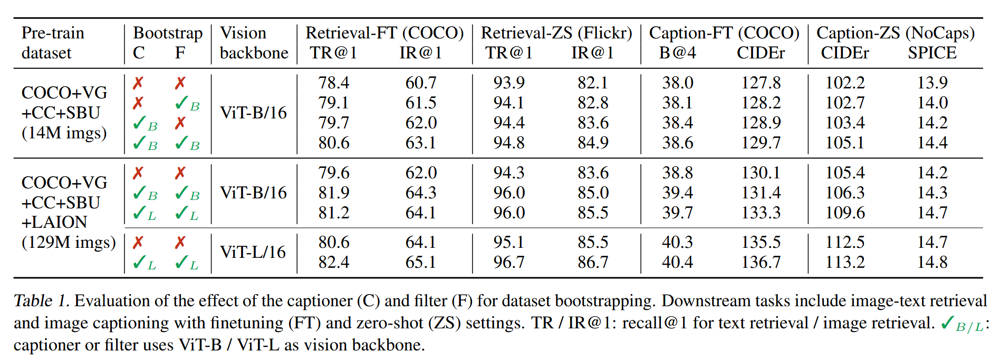

表中：

- `C` 表示 Captioner；
- `F` 表示 Filter；
- `FT` 表示微调；
- `ZS` 表示 zero-shot；
- TR@1、IR@1 分别是文本检索和图像检索 Recall@1。

Filter 和 Captioner 各自都能提升效果，但联合使用最好。

它们解决的是两个不同问题：Filter：删除错误监督；Captioner：增加新的、视觉相关的描述。所以CapFilt的效果不是单纯来自数据变多，也不是单纯来自过滤，而是“补写信息+去除噪声”的组合。

该表也显示了在更大数据和更大视觉骨干下，CapFilt 仍然有提升，说明它不是只对某个小规模设置有效。

## 四、局限性

虽然 BLIP 很强，但它本质上还是在训练自己的视觉语言模型
随着视觉模型越来越大，语言模型也越来越大。如果每做一个视觉语言模型，都重新端到端训练代价非常大。于是 BLIP-2 出现了。

# 三、BLIP-2: Bootstrapping Language-Image Pre-training with Frozen Image Encoders and Large Language Models（Blip-2：引导式语言-图像预训练，采用冻结图像编码器和大型语言模型）

## 一、研究背景与动机

问题：

VLP 模型越来越大，端到端预训练计算成本极高。同时，视觉和语言社区已经有大量现成的强大单模态模型（CLIP 图像编码器、LLM），但现有 VLP 方法无法灵活利用它们。

核心思路：

BLIP-2 因此采用冻结的 image encoder、冻结的 LLM，只训练中间的轻量 Q-Former，并用两阶段训练完成视觉—语言对齐。

## 二、方法详解：

Q-Former 全称：Querying Transformer（查询式Transformer）。它主动从大量 image tokens 中抽取最有用的信息。BLIP-2 设置了 32 个可学习的 Query，这些 Query 通过 Cross-Attention 去“查询”图像特征。

它同时包含图像侧和文本侧处理能力：

- Query 通过 Cross-Attention 读取图像；
- Query 之间通过 Self-Attention 交流；
- Query 还可以与文本 token 交互；
- 不同训练任务使用不同的 Attention Mask（注意力掩码）。

### 1、模型架构：

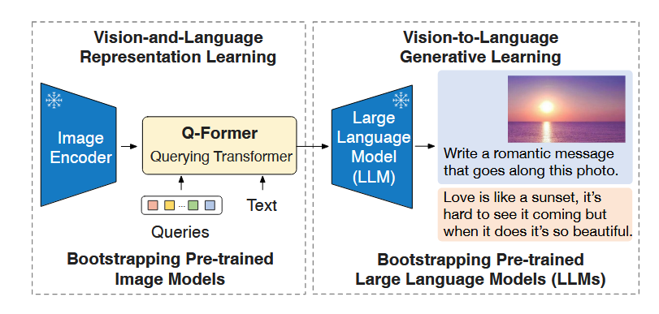

  图示为BLIP-2 的整体框架结构，核心思想是通过一个轻量级的 Q-Former（Querying Transformer），将已经训练好的视觉模型（Image Encoder）和大型语言模型（LLM）连接起来，实现从图像到语言的生成能力。整个过程分为两个阶段：第一阶段是 Vision-and-Language Representation Learning（视觉-语言表示学习），模型冻结预训练好的 Image Encoder，通过 Q-Former 中的可学习 Query 从图像特征中提取与语言相关的信息，并利用文本信息进行视觉和语言对齐；第二阶段是 Vision-to-Language Generative Learning（视觉到语言生成学习），将 Q-Former 输出的视觉表示映射到 LLM 能理解的特征空间，并作为视觉提示（visual prompt）输入冻结的大语言模型，使 LLM 能够结合图像内容完成文本生成任务，例如根据图片生成描述、回答问题或进行视觉对话。BLIP-2 不再直接训练庞大的视觉模型和语言模型，而是学习一个连接两者的桥梁 Q-Former，从而以较少的训练参数实现强大的视觉语言理解和生成能力。
  BLIP-2 的核心贡献不是重新训练视觉模型或语言模型，而是设计 Q-Former 作为视觉信息到语言模型之间的接口，让已有的强大视觉模型和 LLM 能够协同工作。

### 2、两阶段预训练策略

#### 第一阶段：从冻结图像编码器引导视觉-语言表示学习（看懂图）

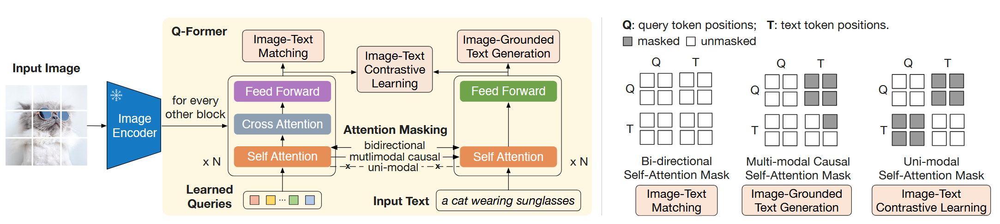

  这张图展示了 BLIP-2 中 Q-Former 的核心结构和训练方式。首先，输入图像经过冻结的 Image Encoder 提取视觉特征，随后 Q-Former 利用一组可学习的 Query tokens，通过 Cross Attention 主动从视觉特征中提取与语言相关的重要信息，实现视觉信息的压缩与表示学习。为了训练 Q-Former 的视觉语言能力，作者设计了三种不同的 Attention Mask，并对应三个训练目标：在 Image-Text Contrastive Learning（ITC） 中，采用单模态 Attention，使图像和文本分别编码后进行语义对齐；在 Image-Text Matching（ITM） 中，采用双向 Attention，使 Query 与文本充分交互，学习细粒度的图文匹配关系；在 Image-Grounded Text Generation（ITG） 中，采用因果 Attention，使模型能够结合图像信息生成描述文本。通过这三个任务的联合训练，Q-Former 学会从视觉特征中提取适合语言理解的信息，并将其作为连接视觉模型和大语言模型（LLM）的桥梁，为后续视觉到语言的生成任务提供有效的视觉表示。

#### 第二阶段：从冻结 LLM 引导视觉到语言的生成学习

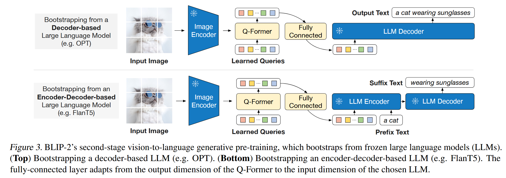

  这张图展示了 BLIP-2 第二阶段视觉到语言生成学习中，Q-Former 与不同类型大语言模型（LLM）的连接方式。首先，输入图像经过冻结的 Image Encoder 提取视觉特征，再由 Q-Former 利用可学习 Query 提取与语言相关的视觉信息，并通过全连接层将视觉表示映射到 LLM 能够理解的特征空间。对于 Decoder-only LLM（如 OPT），Q-Former 输出的视觉特征会作为 visual prefix tokens（视觉前缀提示），与文本提示一起输入 大语言模型编码器（LLM Decoder），使模型根据图像信息直接生成文本；对于 Encoder-Decoder LLM（如 FlanT5），视觉特征则作为前缀输入 LLM Encoder，与文本信息共同编码，再由 Decoder 完成文本生成。通过这种设计，BLIP-2 无需微调庞大的视觉模型和语言模型，仅通过训练 Q-Former 作为视觉与语言之间的桥梁，就能够将不同结构的预训练 LLM 扩展为具备视觉理解和生成能力的多模态大模型。

## 三、实验部分

### 1、为什么必须分两阶段训练

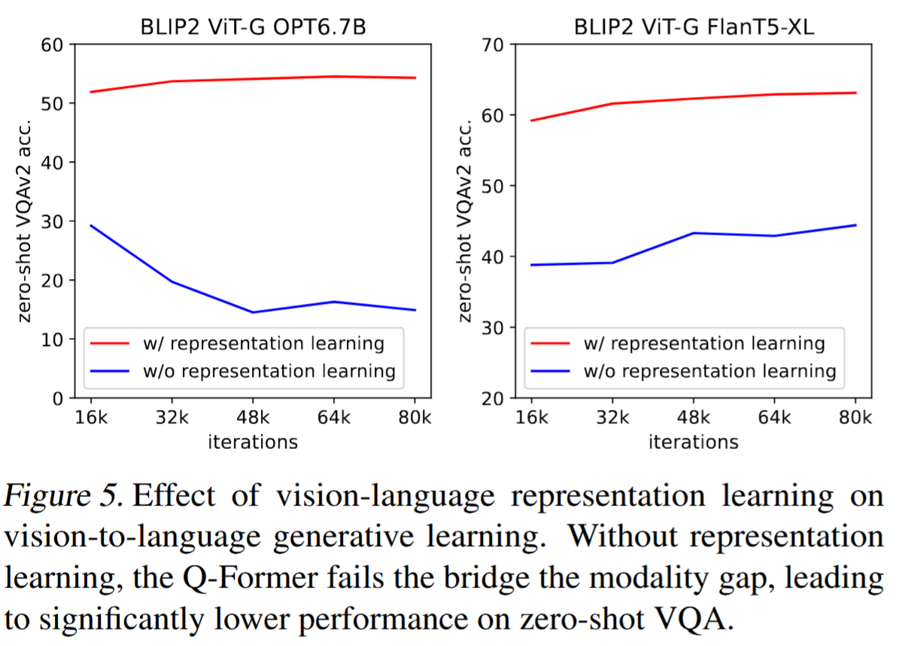

横轴是第二阶段训练迭代次数，纵轴是 zero-shot VQAv2 准确率。每张图都有两条曲线：

- `w/ representation learning`：先完成第一阶段；

- `w/o representation learning`：直接训练视觉到语言生成。

  有第一阶段训练时，VQA 性能明显更高、更稳定。

  没有第一阶段时：FlanT5 的性能明显较低；OPT 的性能甚至随着训练继续而下降。

原因：如果跳过第一阶段，Q-Former 一上来就需要同时解决两个问题：

1. 从数百个视觉 token 中提取重要内容；
2. 把这些内容转换成冻结 LLM 能理解的表示。

任务繁重。

第一阶段先用 ITC、ITM、ITG 教会 Q-Former：图片中哪些内容与文本有关

第二阶段才学习：如何把这些内容写成 LLM 能理解的 soft prompt？

这张图直接支持：第一阶段负责提取、第二阶段负责翻译

### 2、针对更强的视觉编码器和更强的 LLM 都有用

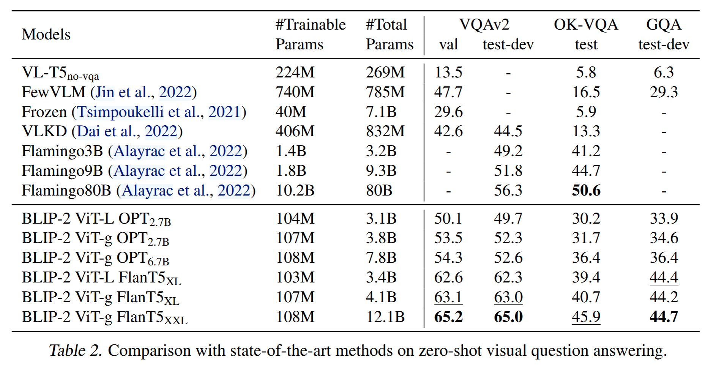

可以纵向做三组对比。

- 更换视觉编码器，保持 OPT-2.7B 不变：

ViT-L：VQAv2 50.1 

ViT-g：VQAv2 53.5

说明更强的视觉编码器提高视觉理解能力。

- 增大 LLM保持 ViT-g 不变：

OPT-2.7B：53.5
OPT-6.7B：54.3

说明语言模型变大后有所提升

- 使用指令微调 LLM，同样使用 ViT-g：

OPT 系列：约 53–54
FlanT5-XL：63.1
FlanT5-XXL：65.2

  这张表证明Q-Former 没有完全取代两端模型的能力。BLIP-2 最终性能来自三部分：视觉编码器能力+Q-Former 对齐能力+LLM 语言与指令能力
  这是模块化架构的价值：视觉模型或 LLM 单独升级，系统就可能直接受益。

## 四、BLIP-2 为什么训练成本低很多

因为最大的两块：image encode和LLM都被冻结。它只需要训练：Q-Former+Projection（可训练的线性投影层）
因此 BLIP-2 不需要重新学习：什么是猫、什么是车、什么是天空这些视觉模型早就会的知识。也不需要重新学习：英语语法、世界知识、推理方式LLM 早就会。它只需要学习：如何把视觉信息翻译给 LLM。它把训练视觉和语言变成了训练视觉语言交互

## 五、局限性

1. 缺乏上下文学习能力：给 LLM 提供 few-shot VQA 示例并未提升性能，因为预训练数据每个样本只有一对图文，LLM 无法学到多对图文间的关联。
2. 生成可能不准确：LLM 知识不准确、推理路径错误、信息过时（论文Figure 6 展示了错误案例）。
3. 继承 LLM 风险：可能输出冒犯性语言、传播社会偏见、泄露隐私。

## 核心思路对比

|   维度   |                 CLIP                 |             BLIP             |              BLIP-2              |
| :------: | :----------------------------------: | :--------------------------: | :------------------------------: |
| 核心目标 | 学习可迁移的图像表示，支持零样本分类 |    统一视觉语言生成和理解    | 高效利用冻结的图像编码器+冻结LLM |
| 关键贡献 |  图文对比预训练+自然语言零样本迁移   |   MED架构+CapFilt数据自举    |      Q-former+两阶段预训练       |
| 模型结构 |               双编码器               | MED（可切换encoder/decoder） | Q-former+冻结图像编码器+冻结LLM  |
| 训练方式 |            端到端对比学习            |      端到端多任务预训练      |     只训练Q-former，冻结其余     |

三者的演进：

\[ \boxed{ \text{CLIP：建立图文共同空间} \rightarrow \text{BLIP：增加细粒度理解、生成和数据清洗} \rightarrow \text{BLIP-2：冻结强模型，只训练视觉—语言接口} } \]

- **CLIP** 学会判断“这张图最像哪句话”。
- **BLIP** 不仅判断，还能让图文深度交互，并根据图片生成文字。
- **BLIP‑2** 不再重新训练完整视觉语言模型，而是把已有视觉模型“接入”已有 LLM。