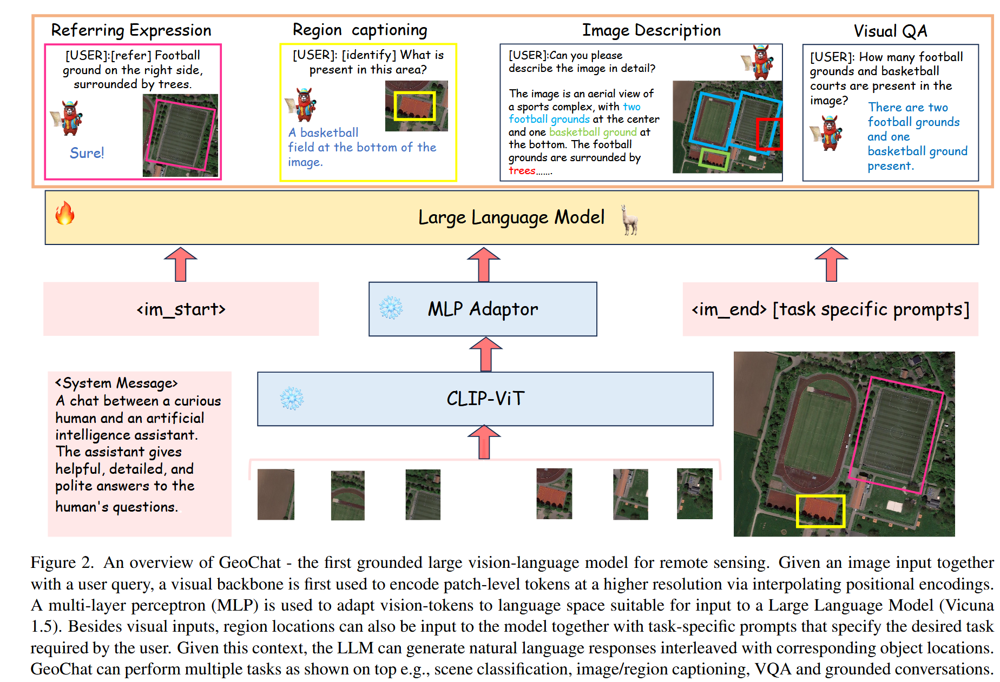
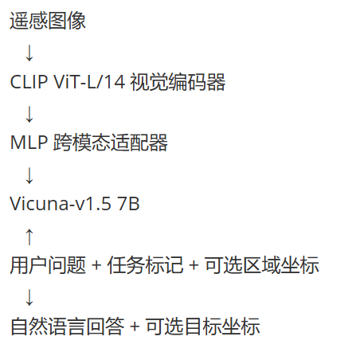
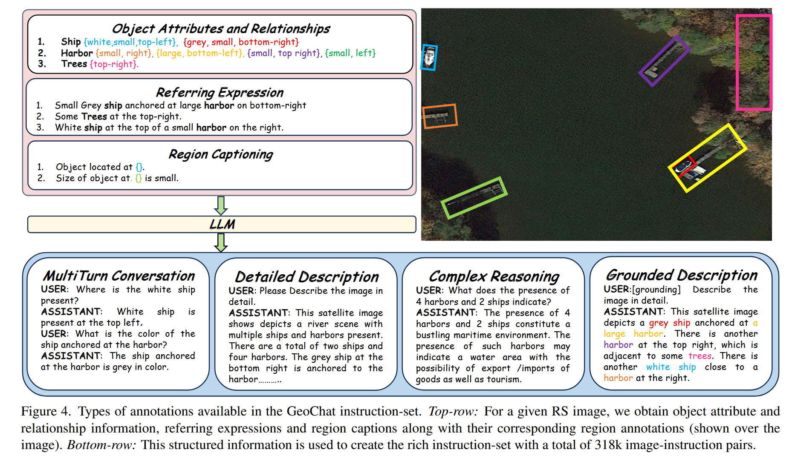

# GeoChat阅读笔记：

## 一、 论文要解决什么问题

通用视觉语言模型如 LLaVA、MiniGPT、Qwen-VL 主要学习自然图像，在遥感图像上容易遇到几个问题：

- 拍摄视角是俯视，外观与普通照片差异很大；
- 同一图中可能有大量飞机、车辆、船舶等小目标；
- 目标尺度变化非常大；
- 用户经常需要询问某一个局部区域，而不是整幅图；
- 遥感任务需要明确空间位置，例如“右下角的小型白色飞机在哪里”。

传统遥感 VQA 通常把回答限制在预先定义的类别中，不是真正的开放式对话；较早的遥感多模态模型也往往需要针对每个任务单独训练。

因此，作者希望用一个统一模型同时完成：

- 场景分类；
- 图像描述；
- 视觉问答；
- 多轮对话；
- 区域描述与区域问答；
- 指代表达定位；
- 带目标坐标的 grounded conversation（可定位对话）。

## 二、GeoChat最重要的创新

遥感领域适配 + 多任务统一 + 区域理解 + 视觉定位（Visual Grounding）。

GeoChat 相比普通“看图聊天模型”多了一层Grounding：把语言中的目标与图像中的具体空间区域对应起来。语言↔图像区域

## 三、GeoChat能做哪些任务

### 1、Image-Level Conversation（整图理解）

输入：Image + Question

这一类包含：场景分类、图像描述、视觉问答、普通多轮对话。

### 2、Region-Level Conversation （区域级对话）

输入：Image + Bounding Box + Question。

因为存在边界框（Bounding Box）所以模型只针对这个区域回答。

论文明确指出，区域定位会作为额外输入，引导模型针对指定区域完成 区域描述、区域级视觉问答或多轮对话。也就是：不只是“文字告诉模型看哪里”，还可以直接“框给模型看”。

### 3、Grounded Conversation （可定位对话）

论文核心部分：模型不仅理解位置输入，还可以输出位置

模型最终需要生成对应的边界框

也就是说：

Image + Text —> Text + Bounding Box

因此 GeoChat 可以完成：

- Referring Expression → 找目标
- Grounded Caption → 描述目标并给位置
- Region Caption → 给区域描述
- Grounded Conversation → 对话过程中输出目标位置

论文用三个 task token 来区分这些空间任务：

\[ t \in \{grounding,\ identify,\ refer\} \]

- [identify]：输入区域坐标，让模型描述该区域；
- [refer]：输入目标描述，让模型输出目标位置；
- [grounding]：生成描述的同时给出所提目标的位置。

分别对应 可定位对话（grounded conversation）、区域级图像描述（region captioning） 和 指代表达（referring expression）

## 四、GeoChat的整体网络结构

### 1、整体结构:

  这张图展示了 GeoChat 的整体架构。GeoChat 基于 LLaVA-1.5（大语言模型与视觉助手） 构建，首先利用 CLIP-ViT 对高分辨率遥感图像进行视觉特征提取，并通过提高输入分辨率获得更细粒度的 patch 特征；随后利用多层感知机适配器（MLP Adapter） 将视觉特征映射到 Vicuna-1.5 所使用的语言空间，再将视觉 token、用户问题以及任务特定提示（ task-specific prompt ）一同输入大语言模型进行统一推理。与普通 LLaVA 不同的是，GeoChat进一步引入了区域坐标表示和 grounding、identify、refer 等任务标识，使模型既能够理解用户指定的图像区域，也能够在生成自然语言回答的同时输出目标空间位置。因此，同一模型可以统一完成图像描述、视觉问答、区域描述、指代表达以及可定位对话等多种遥感视觉语言任务

  它本质上沿用了 LLaVA-1.5 的基本架构，主要创新不是重新设计一个全新的网络，而是加入了遥感数据、空间坐标表示和多任务指令格式。

### 2、模型的训练过程

训练时使用：

- 冻结的 CLIP ViT-L/14；
- 冻结的预训练 MLP 适配器；
- Vicuna-v1.5 7B；
- 使用 LoRA 微调 Vicuna 的注意力参数，秩 `r=64`。

#### 1、CLIP-ViT

CLIP-ViT 作为视觉编码器，作用就是把遥感图像I转换成大量视觉Token:

\[ I \rightarrow \{v_1,v_2,\cdots,v_n\} \]

每一个 token 可以理解成图像某一小块区域的信息。但这里遇到一个遥感领域特有的问题：CLIP 原始分辨率太低。原本 CLIP 输入：336 x 336。大约得到：576个 patch。但是遥感图像里面大量都是小目标，比如：小汽车、飞机、船舶。336×336 很容易看不清。所以作者通过位置编码插值，把输入提高到：504 × 504 于是视觉 patch 数增加到：1296。这样模型相当于获得了更细粒度的视觉信息，更有利于识别和定位遥感图中的小目标。

#### 2、MLP Adapter

CLIP 和 Vicuna 本来不是一个系统。CLIP 输出视觉特征维度是：1024维。但 Vicuna 的语言嵌入维度是：4096维。所以不能直接连接。因此中间加一个：多层感知机跨模态适配器完成：把1024维视觉嵌入投影成4096维。这样视觉 token 就进入了 Vicuna 可以理解的表示空间。这一步可以把它理解成一个：视觉 → 语言翻译器。MLP Adapter实现维度对齐和语义对齐让图像的内容能被LLM“读懂”

#### 3、Vicuna-1.5

GeoChat 使用的是：Vicuna-v1.5 7B作为语言模型。

Vicuna负责：

- 理解用户问题
- 理解视觉 token
- 理解任务 token
- 理解边界框
- 进行推理
- 最后生成答案

因此：CLIP = 眼睛；MLP = 视觉语言连接器；Vicuna = 大脑

训练分两阶段：

1. 使用全部任务数据训练 1 个 epoch，共约 2400 steps；
2. 只使用 grounding 数据再训练约 1600 steps。

这种方式训练成本较低，也有助于保留 Vicuna 原有的语言和对话能力。不过，由于视觉编码器被冻结，对遥感视觉特征的适配能力会受到限制。

### 3、模型训练参数

作者没有把整个模型全部微调。

- CLIP：**冻结**

- MLP Adapter：**冻结**

主要使用：**LoRA**微调 Vicuna。

训练分为两个阶段：

- 第一阶段：全部任务数据；训练：\[ 1\ epoch \approx 2400\ steps \]

- 第二阶段：只训练：Grounding 数据  约：\[ 1600\ steps \]

图像训练分辨率统一为：\[ 504\times504 \]

优化器是：AdamW。并使用余弦学习率调度器。 

这样做的一个目的就是：降低训练成本，同时尽量保留 Vicuna 原本的语言能力。

## 五、构建318K 遥感指令数据集

### 1、整合多种遥感数据集：

- DOTA、DIOR、FAIR1M：目标检测；
- NWPU-RESISC-45：场景分类；
- RSVQA-LRBEN：视觉问答；
- FloodNet：洪水灾害问答。

在检测数据上，作者进一步构造五类目标属性：

| 属性     | 示例               |
| -------- | ------------------ |
| 类别     | 飞机、船舶         |
| 颜色     | 白色、灰色         |
| 相对大小 | 小型、普通、大型   |
| 相对位置 | 左上、中心、右下   |
| 对象关系 | 停在、穿过、被包围 |

生成方式比较工程化：

- 颜色：对目标像素做 K-Means，取最大簇颜色；
- 大小：按同类别面积的 20% 和 80% 分位数划分；
- 位置：把图像划成 `3×3` 网格；
- 关系：根据目标框距离、类别组合和空间包含关系推断；
- 缺失的建筑、道路、树木等类别由另一个遥感模型生成伪标签；
- 最后让 Vicuna 根据结构化描述生成详细描述、多轮对话和复杂问答。

最终得到约：

- 306k 训练指令；
- 12k 测试指令；
- 合计约 318k。

这套流程的关键思想是：把已有分类、检测和 VQA 数据集，统一转换成“用户问题—助手回答”的对话格式。

### 2、数据生成流程

Figure 4 展示了 GeoChat 构建指令数据集时所用标注的结构化生成流程：上半部分以一张港口遥感图为例，先由目标检测标注提取出物体属性（如“白色、小型、左上”的船只）、物体间关系（如“灰色小船停靠在大港口旁”）、指代表达（“右上角的一些树木”）以及区域描述（“物体位于某处，尺寸较小”），这些结构化信息（类别、颜色、大小、位置、关系）统一送入 LLM；下半部分则显示 LLM 基于这些信息生成四种丰富的指令-回答对——多轮对话（如询问船只位置与颜色）、详细描述（整幅卫星图的场景叙述）、复杂推理（如由港口与船只推断贸易或旅游功能）以及可定位描述（在叙述中为每个物体附带边界框坐标），最终汇总为 318k 图像-指令对的数据集。

原始遥感检测数据里可能只有：

- Ship
- Harbor
- Trees
- 以及 bounding box。

作者先把它加工成：物体属性。

比如：

- ship
- white
- small
- top-left

于是得到：

- small white ship at top-left

然后加入关系：anchored at harbor

最后形成：Small grey ship anchored at large harbor on bottom-right.

这种文本就叫：指定表达（Referring Expression）

然后再让 Vicuna 基于这些结构化信息自动产生更多：

- Detailed Description
- Multi-turn Conversation
- Complex Reasoning
- Grounded Description

上图展示了从物体属性、物体关系、指定表达、区域描述。进一步生成多轮对话、详细描述和复杂推理数据的过程。

所以它的数据构建本质上是：

\[ Detection\ Annotation \]

↓

\[ Object + Attribute + Relation \]

↓

\[ Short\ Description \]

↓

\[ LLM \]

↓

\[ Multimodal\ Instruction\ Data \]

这是这篇论文非常重要的思想：利用已有遥感标注 + LLM，低成本构造大规模多模态指令数据。

## 六、实验结果

### 1、任务结果

论文主要从三类任务验证：

> Scene Classification
> VQA
> Visual Grounding

### 场景分类

在零样本设置下：

| 模型        | UCMerced  | AID       |
| ----------- | --------- | --------- |
| Qwen-VL     | 62.90     | 52.60     |
| LLaVA-1.5   | 68.00     | 51.00     |
| **GeoChat** | **84.43** | **72.03** |

GeoChat 在遥感零样本分类上明显超过通用 VLM。

论文认为主要原因就是：**GeoChat获得了遥感领域知识。**

### 2、VQA结果

在 RSVQA-LRBEN 上，GeoChat 和一些专门训练的遥感 VQA 模型相比已经比较接近。

特别是：GeoChat 并没有针对测试目标数据集进行单独微调。论文强调：GeoChat它是一个通用模型。而 RSGPT 等部分对比模型则是针对目标任务进行微调的。

这说明 GeoChat的价值并不一定是：“每一个任务都必须第一名。”而是：一个模型同时做很多事情，而且 zero-shot 表现还不错。

## 七、主要局限

- **定位能力仍然很弱**：总体 [acc@0.5](mailto:acc@0.5) 只有 10.6。

- **小目标问题没有解决**：小目标定位只有 2.9。

- **504×504 仍会丢失遥感细节**

- **训练数据噪声较大**：包含伪标签、K-Means 颜色、规则关系和 LLM 自动生成对话。

- **训练和测试构造方式相似**：可能使区域描述等指标偏乐观。

- **部分比较并不完全公平**：通用模型是直接零样本测试，而 GeoChat 已进行大规模遥感领域训练。

- **缺少真实用户和专家评估**：主要依赖自动指标。

- **坐标被当作普通数字 token 生成**：语言模型没有专门的几何预测头，因而很难实现精确定位。

## 八、理解 GeoChat 和 CLIP / BLIP / LLaVA 的关系

可以把它看成一条发展路线：

CLIP主要解决：**图像和文本怎么对齐？**

↓

BLIP/BLIP-2进一步解决：**怎么让视觉和语言模型更好结合，实现理解和生成？**

↓

LLaVA解决：**如何用视觉指令微调，让大语言模型“看图聊天”？**

↓

GeoChat进一步解决：**如何让 LLaVA 进入遥感领域，并且具备区域理解和目标定位能力？**

## 九、总结

GeoChat 是一个面向遥感场景的 Grounded Large Vision-Language Model，它基于 LLaVA-1.5 构建，以 CLIP-ViT 作为视觉编码器、MLP Adapter 完成视觉到语言空间的映射，并以 Vicuna-1.5 作为大语言模型。针对遥感图像分辨率高、小目标多以及需要区域级空间推理的问题，作者提高视觉输入分辨率，并将边界框坐标表示为语言形式，同时通过 grounding、identify 和 refer 等任务 token 统一图像级、区域级和视觉定位任务。此外，作者利用 DOTA、DIOR、FAIR1M、RSVQA、NWPU-RESISC-45 等已有遥感数据构建了约 318K 的多模态指令数据集，并利用 LoRA 对语言模型进行高效微调。实验表明 GeoChat 在遥感场景分类和 VQA 的 零样本设置下明显优于通用 VLM，同时具备此前遥感大模型较弱的区域级推理和视觉定位能力；不过其小目标和多目标定位的准确率仍然较低，说明精细空间定位仍是一个明显瓶颈。