# 10.26周报

# GeoChat : Grounded Large Vision-Language Model for Remote Sensing(GeoChat:面向遥感的带视觉定位的大型视觉-语言模型)

## 一、研究背景和动机

### 1、通用VLM在遥感问题上表现差

- 拍摄视角是俯视，外观与普通照片差异很大；

- 同一图中可能有大量飞机、车辆、船舶等小目标；

- 目标尺度变化非常大；

- 用户经常需要询问某一个局部区域，而不是整幅图；

- 遥感任务需要明确空间位置，例如“右下角的小型白色飞机在哪里”。

结果：通用模型在遥感查询上会给出错误信息甚至幻觉

### 2、已有遥感VLM的局限

早期遥感 VQA 方法经常把回答当成分类标签：从训练集中预先规定的一组答案中选择一个，而不是自由生成自然语言。

这会限制：

- 开放式回答；
- 多轮对话；
- 新任务上的指令遵循；
- 对目标位置和局部区域的表达。

论文还指出，RSGPT 已具备一定遥感对话能力，但不同任务往往需要分别微调，而且不能进行区域级推理和视觉定位

### 3、缺少数据、缺少评估基准

- 遥感领域没有多模态指令跟随（instruction-following）对话数据集；
- 也没有评估"遥感对话 + 定位"能力的基准。

## 二、核心贡献

1. RS 多模态指令数据集：用自动化 pipeline 从现有遥感数据集生成约 318k 指令对。
2. GeoChat 模型：基于 LLaVA-1.5 做 LoRA 微调，得到首个支持多任务、带定位能力的遥感 VLM。
3. 建立多任务评测体系：建立了遥感对话 grounding 的评测协议和任务套件（referring、grounding、region captioning 等）。

## 三、方法详解

### 1、支持的三类任务：

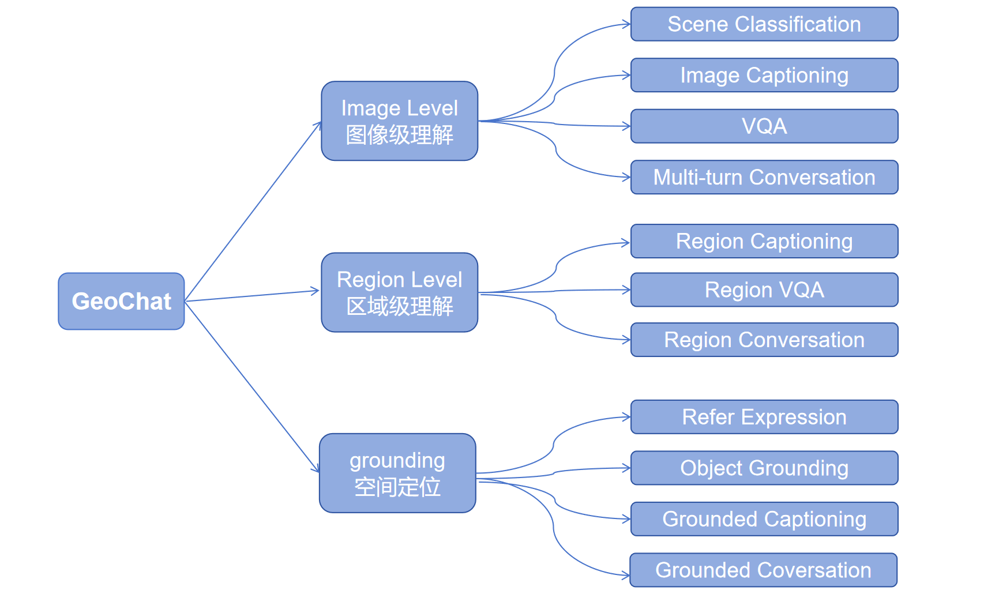

**三类任务标记：**

作者使用特殊 token 区分任务：\[ t\in\{\text{grounding},\text{identify},\text{refer}\} \]

- grounding：用于带视觉定位的描述或对话。（模型需要在自然语言描述中同时给出相关目标的位置）
- identify：用于区域级理解（用户在问题中给出一个区域框，模型根据该框描述局部物体）
- refer：用于指代表达理解或检测（模型根据语言找到对应目标，并输出其空间位置。）

没有特殊 token 时，则执行普通图像描述、VQA、分类或对话。

### 2、GeoChat的整体架构：

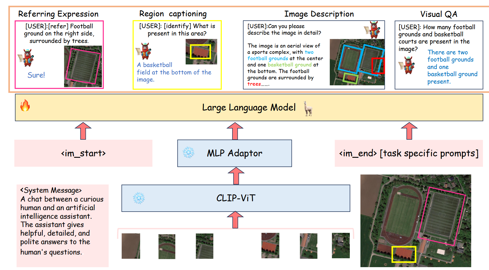

  图2展示了 GeoChat 如何把高分辨率遥感图像编码成视觉 token，经 MLP 映射后送入 Vicuna，再通过任务标记和文本化坐标，让同一个语言模型完成整图问答、区域描述、指代表达定位以及带目标位置的图像描述。

模型的数据流可以理解为：

​        遥感图像
​               ↓

​        视觉编码器（CLIP ViT-L/14 ，原分辨率336*336）
​               ↓
​        MLP 跨模态适配器（两层线性层，1024 -> 4096维，GeLU激活）
​               ↓
​        LLM（Vicuna-v1.5 7B）
​               ↓
​        文本及空间坐标

#### 2.1 提高视觉分辨率：

原始 CLIP 输入为 `336×336`，对应 576 个视觉 patch。GeoChat 将位置编码插值到 `504×504`，视觉 token 数增加到 1296。这样做是为了保留更多小目标信息。但  504×504 对真正的大幅遥感影像来说仍然不算很高，因此小目标定位依旧困难。

#### 2. 2 MLP跨模态适配器  

冻结的 CLIP 输出：1296个视觉 token，每个1024维。

MLP适配器包含两层线性层和一个隐藏层，使用 GeLU 激活，把每个视觉 token 从1024维映射到4096维。4096正好对应 Vicuna-1.5 7B 的输入嵌入维度。

它的作用是把“视觉语言”翻译成 LLM 能接收的表示。

#### 2.3 大语言模型：

语言部分使用 Vicuna-1.5 7B，负责：

- 解释用户指令；
- 结合图像 token 和区域坐标；
- 生成自然语言；
- 把边界框表示成文本 token；
- 支持多轮对话。

### 3、空间坐标是如何表示的：

Bounding Box （边界框）被直接写成文本：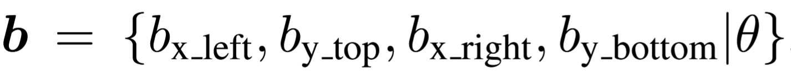

其中：

- **四个坐标归一化到 0～100：**坐标不依赖图像原始像素尺寸；同一套表示可跨数据集、跨分辨率通用，迁移性好
- **`θ` 表示旋转框相对其下边缘的角度：**适配遥感目标的朝向
- **统一了”输入“和”输出“：**同一个文本格式既当"视觉提示"又当"定位结果"，不需要额外的检测头或坐标回归分支，只需要LLM 一个接口。这是它"统一框架"能成立的关键。
- **纯文本表示：**直接复用LLM的词表与生成能力。
- **角点表示：**表达直观、与检测标注对齐。

也就是说，模型把“目标检测”转换成了一种语言生成任务。

### 4、训练策略：

训练时使用：

- 冻结的 CLIP ViT-L/14；
- 冻结的预训练 MLP 适配器；
- Vicuna-v1.5 7B；
- 使用 LoRA 微调 Vicuna 的注意力参数，秩 `r=64`。

训练分两阶段：

1. 使用全部任务数据训练 1 个 epoch，共约 2400 steps；
2. 只使用 grounding 数据再训练约 1600 steps。

这种方式训练成本较低，也有助于保留 Vicuna 原有的语言和对话能力。不过，由于视觉编码器被冻结，对遥感视觉特征的适配能力会受到限制。

### 5、318K指令数据是如何构造的：

作者整合了多种遥感数据集：

- DOTA、DIOR、FAIR1M：目标检测；
- NWPU-RESISC-45：场景分类；
- RSVQA-LRBEN：视觉问答；
- FloodNet：洪水灾害问答。

在检测数据上，作者进一步构造五类目标属性：

|   属性   |        示例        |
| :------: | :----------------: |
|   类别   |     飞机、船舶     |
|   颜色   |     白色、灰色     |
| 相对大小 |  小型、普通、大型  |
| 相对位置 |  左上、中心、右下  |
| 对象关系 | 停在、穿过、被包围 |

具体生成方法如下：

- **类别**：来自 SAMRS 标注；

- **颜色**：对目标框内的像素做 K-Means，使用最大聚类中心表示颜色；

- **尺寸**：统计同类别所有实例的面积；

  -   低于第20百分位：small；

  -    高于第80百分位：large；

  -    中间部分：normal；

- **位置**：把图像划分为 \(3\times3\) 网格，根据目标中心点分配 top-left、center、bottom-right 等位置；

- **关系**：先按框之间的距离组织物体子图，再根据类别组合赋予关系；“surrounded by”等关系还会利用像素级包含关系检查。

最终得到约：

- 306k 训练指令；
- 12k 测试指令；
- 合计约 318k。

## 四、实验结果

### 1、场景分类

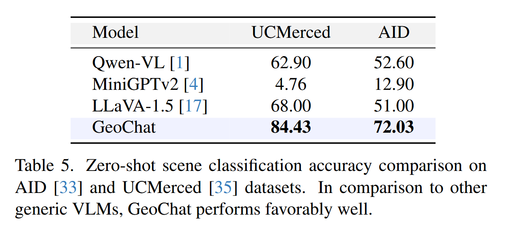

GeoChat在UCMerced 84.43%、AID 72.03%，显著优于其他通用 VLM；
MiniGPT-4-v2 几乎不遵循指令（准确率约 5%）；Qwen-VL、LLaVA-1.5 指令跟随好但缺领域知识。说明遥感领域指令训练明显提高了场景识别能力

### 2、VQA任务

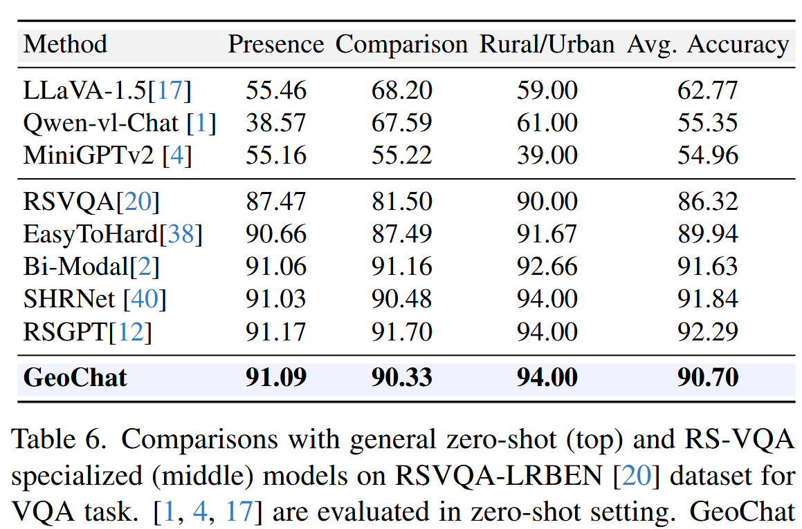

 在遥感视觉问答（低分辨率数据集） GeoChat 平均 90.70%，与专门在目标集上微调的 SOTA（RSGPT 92.29%）相当，明显超过其他零样本模型（LLaVA-1.5 62.77%）。

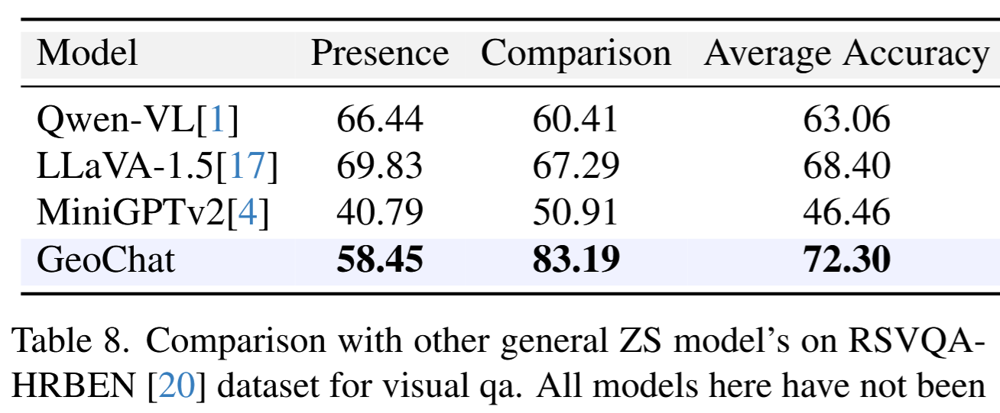

但结果并非所有子任务都更好，在遥感视觉问答（高分辨率数据集）

- GeoChat 在比较问题上达到 **83.19%**；
- 在存在性问题上只有 **58.45%**，低于 LLaVA 的 69.83%。

因此，它的优势主要来自某些空间比较类问题，并不是全面领先。

### 3、视觉定位

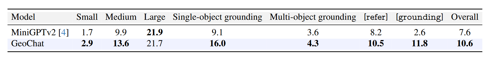

对比 GeoChat 与 MiniGPT-4-v2 在指代/定位任务上的 acc@0.5（交并比阈值下的准确率），并按目标尺寸（small / medium / large，按框面积划分）和单目标/多目标（single / multi-object）分列。

主要结论：

1. GeoChat整体优于 MiniGPT-v2；
2. 在单目标和复杂属性 grounding 上优势较明显；
3. 大目标指标略低于 MiniGPT-v2；
4. 小目标、多目标以及总体绝对准确率依然很低。

 表7的实验结果证明"能做定位"，但同时暴露"定位还不够准"，尤其是小目标和多目标

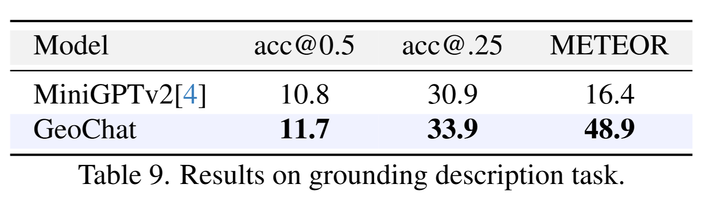

  任务要求模型对整图生成一段描述，并在描述中把提到的目标框出来（文本 + 多个框交错）。评测两方面：
• acc@0.5 / acc@0.25：生成框与真值框的 IoU 达标率（@0.25 是更宽松阈值）；
• METEOR：生成文本与参考描述的语义相似度。 
1、框精度只是"略好"（11.7 vs 10.8，@0.25 也只高 3 个点）——定位仍是短板；
2、文本质量碾压（METEOR 48.9 vs 16.4，约 3 倍）——说明 GeoChat 的语言描述能力是真正的优势，而 MiniGPT-4-v2 基本不会写遥感描述；体现了GeoChat “文本强，定位弱”的不对称优势。

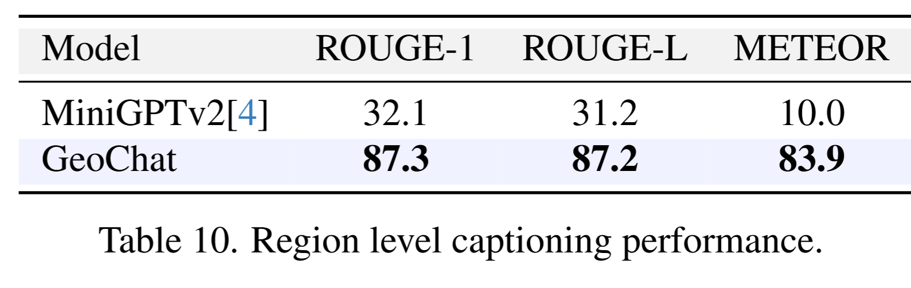

给定一个区域框输入，让模型描述该区域内是什么（如"a white small car")。评测纯文本质量，用 ROUGE-1、ROUGE-L、METEOR 三个指标，不涉及框输出。说明GeoChat区域级对话能力确实落地了。

## 五、总结

### 1、论文的主要贡献

1. **任务统一**
   将遥感分类、问答、描述、区域理解和目标定位统一到一个对话模型中。
2. **空间信息语言化**
   用文本坐标和任务 token，使语言模型可以接收区域提示并输出边界框。
3. **遥感指令数据构造方法**
   展示了怎样把已有遥感数据集批量转化为多轮、多任务视觉指令数据。

### 2、主要局限：

- 小目标定位性能低；

- 多目标预测性能低；

- 整体 grounding 准确率仍然不高；

- 该复杂任务仍有很大的改进空间。

GeoChat 的意义不是证明“大模型已经能够精准理解遥感图像”，而是证明：通过遥感领域指令微调、任务 token 和文本化坐标，可以把原本分散的遥感视觉任务初步统一到一个可对话的视觉语言模型中。但实验也清楚表明：语言生成进步很大，精确空间定位仍然是短板。

## 已完成工作

- 已获取并配置 GeoChat 官方开源代码；

- 已在服务器上创建并配置 `geochat` Conda 环境；
- 已完成 PyTorch、Transformers、OpenCV 等依赖安装；
- 已下载官方预训练模型 `MBZUAI/geochat-7B`；
- 模型权重下载完整，约 14GB；
- 已成功加载 GeoChat 模型；
- 已启动官方提供的 Gradio Web Demo；
- 已可通过浏览器访问：
  `http://10.12.11.141:7860`
- 已能够加载 Demo 中的遥感示例图像及问题

## 当前结果

- GeoChat-7B 已成功加载；
- Web Demo 已成功部署并能够在浏览器访问；
- 示例遥感图像和文本问题能够加载到页面；

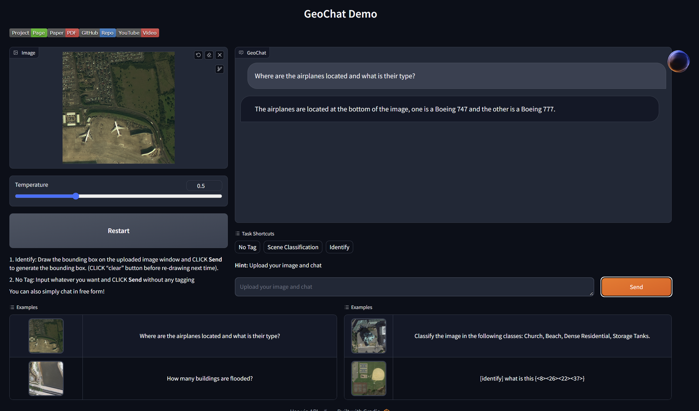

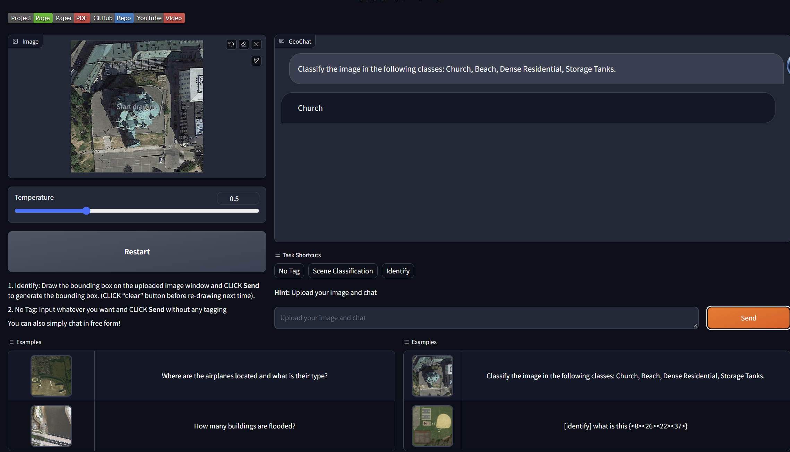

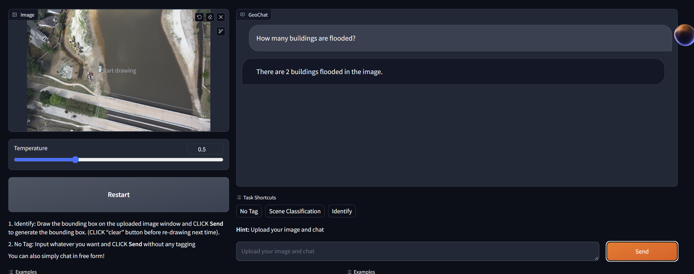

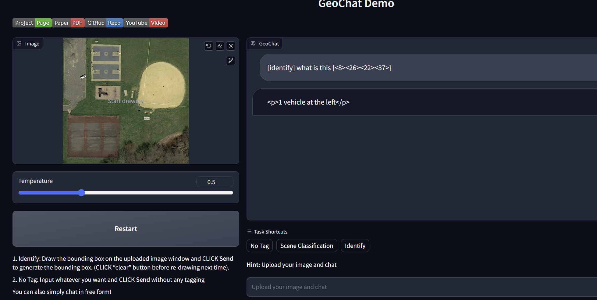

图 1 和图 3：属于 **VQA**。模型根据整张遥感图像回答自然语言问题。

图 2：属于 **场景分类**。模型从指定候选类别中选出图像场景。

图 4：属于 **区域理解**。`{<8><26><22><37>}` 是目标框坐标，告诉模型“只分析这个区域”；模型对框选区域给出“1 vehicle at the left”。

结果表明，模型能够处理整图语义、场景类别、对象数量、对象属性和区域级语义理解等任务。

