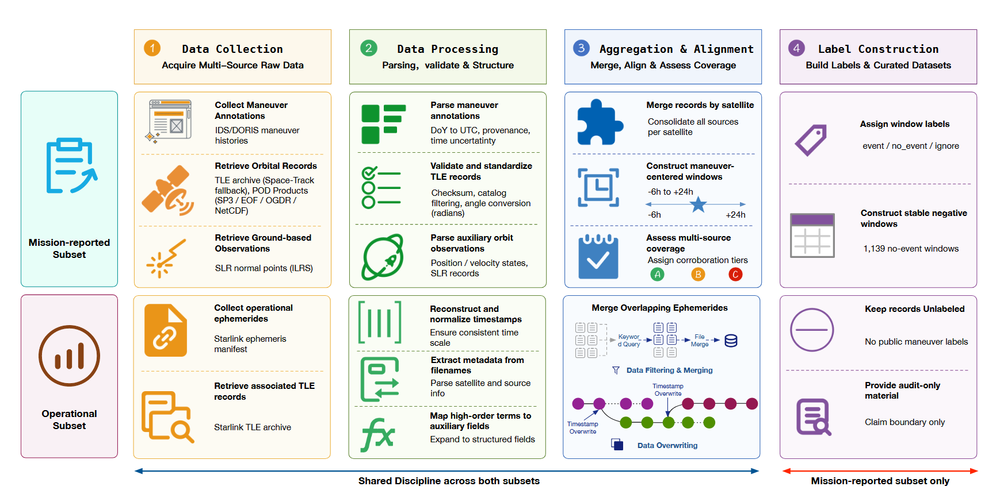
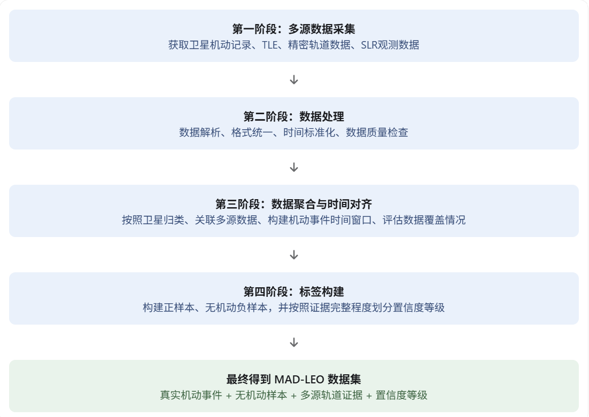
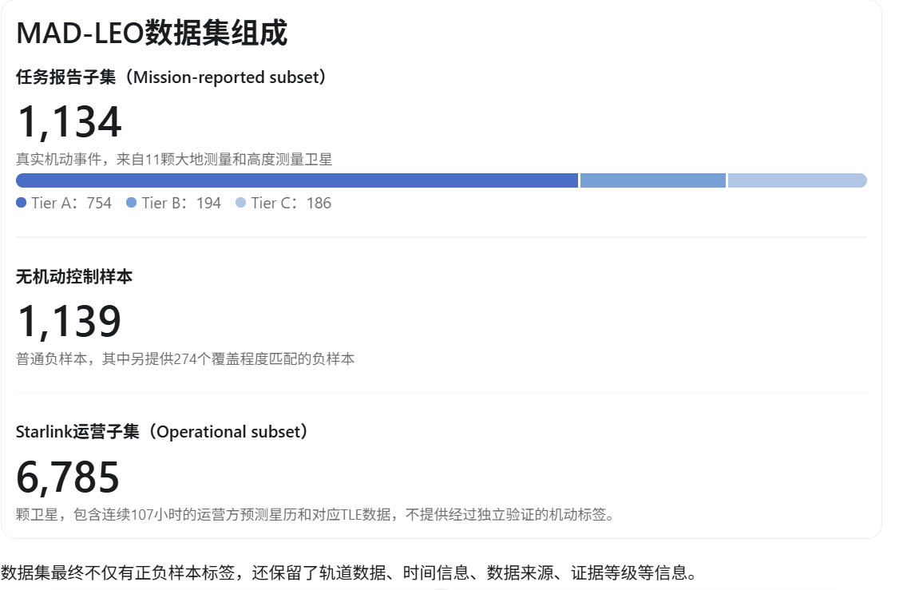
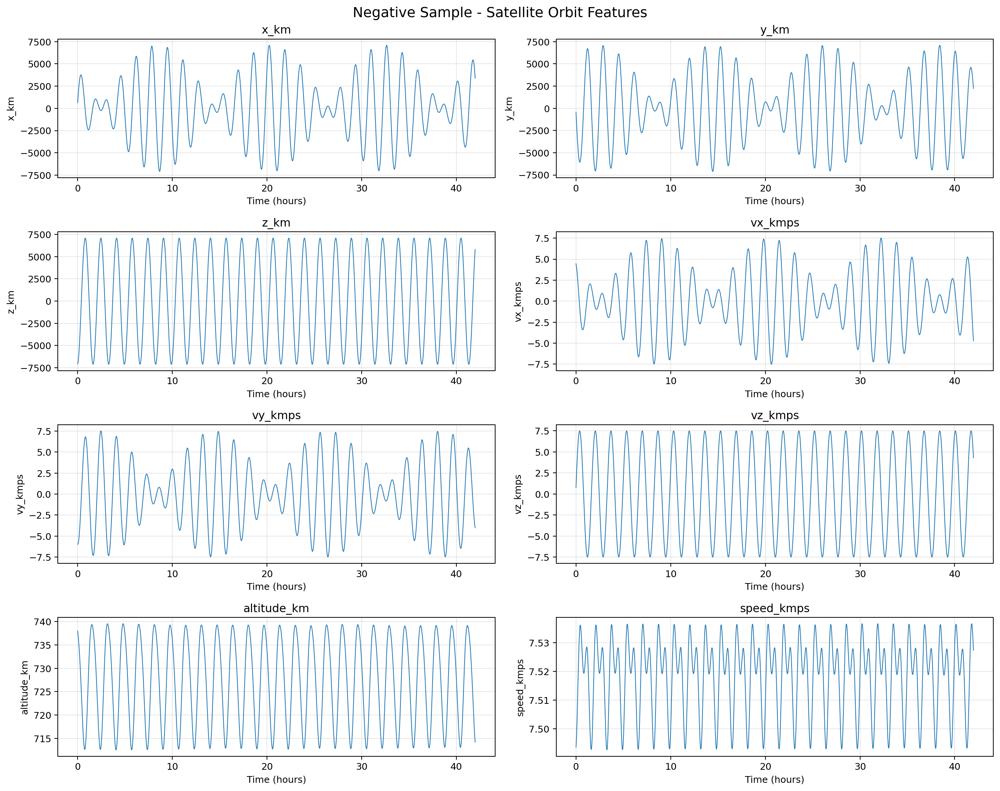
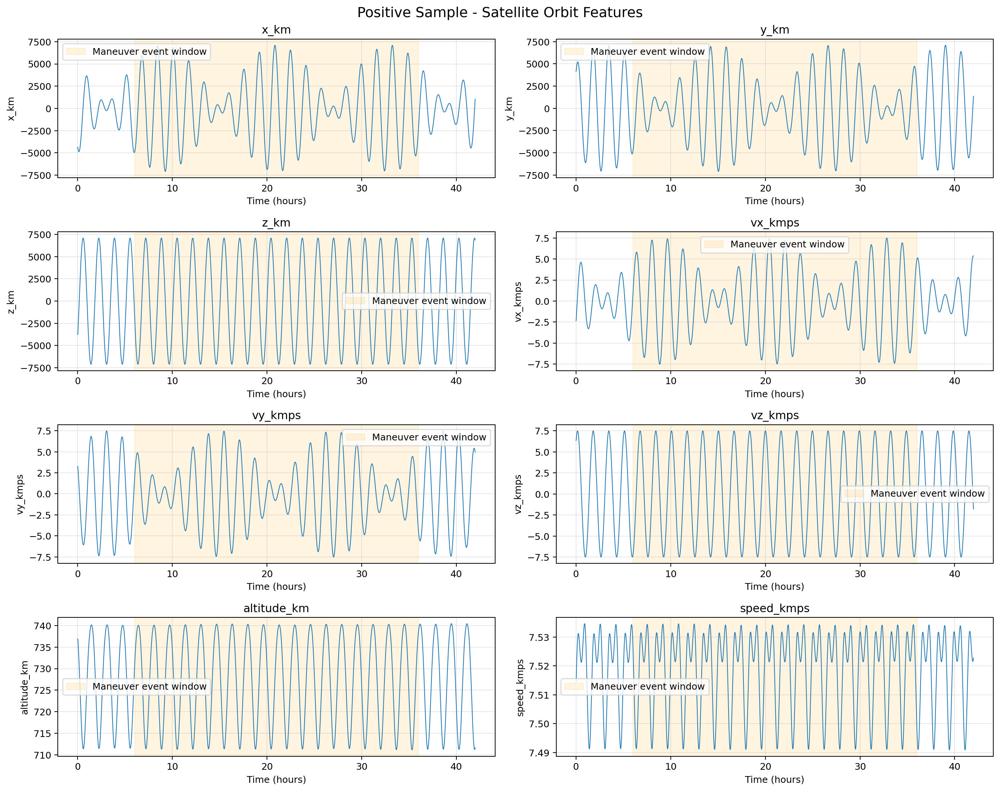
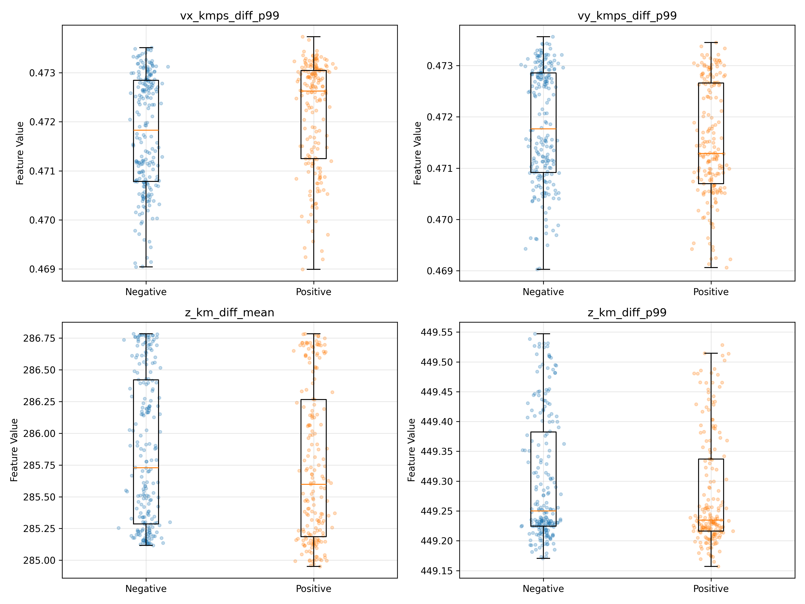

#  《MAD-LEO: A Maneuver-Annotated Orbital Dataset for LEO Satellites with Tiered Multi-Source Evidence》Mad-Leo：一个具有分层多源证据的Leo卫星机动注释轨道数据集。

  主要研究的是低轨卫星（LEO）的轨道机动事件数据集构建。论文的核心贡献不是提出一种新的深度学习机动检测算法，而是构建一个具有真实机动标签、多源轨道证据和置信度分级的数据集，为后续卫星机动检测算法的研究提供可靠的数据基础。

## 一、整体方法路线

论文采用的是一条四阶段的数据集构建路线：

## 二、四个阶段具体做了什么？

### 第一阶段：多源数据采集（Data Collection）

作者没有只依赖一种卫星轨道数据，而是收集了四类数据。

| 数据类型            | 数据来源               | 主要作用                       |
| ------------------- | ---------------------- | ------------------------------ |
| 机动事件记录        | IDS/DORIS              | 提供真实卫星机动时间和事件记录 |
| TLE数据             | CelesTrak、Space-Track | 提供卫星轨道根数               |
| 精密轨道数据（POD） | NASA等数据中心         | 提供高精度位置、速度信息       |
| 卫星激光测距（SLR） | ILRS                   | 从地面测距角度独立验证轨道变化 |

这里有一个关键设计：

机动事件标签来自卫星任务机构发布的机动历史，而不是作者通过轨道数据检测算法生成的。这样可以避免用待验证的检测算法自己生成标签，再用这些标签评价算法的问题。

另外，作者还收集了Starlink卫星的运营方发布星历和对应TLE数据，构成另一套数据集。

### 第二阶段：数据处理（Data Processing）

收集的数据来自不同机构，格式、时间标准和坐标系并不统一，因此需要进行预处理。

主要包括：

1. 数据解析： 从不同文件中提取卫星编号、时间、位置、速度、轨道参数等信息。
2. 数据质量检查： 对TLE进行校验和检查，剔除卫星编号不一致的记录。
3. 时间统一： 将不同数据源的时间统一转换为UTC。
4. 坐标系统一： 对TLE数据进行SGP4轨道传播，并将TEME坐标系转换为ITRF坐标系。
5. 单位统一： 统一位置、速度、角度等物理量的单位。
6. 数据来源记录： 保留每条数据的来源信息，保证后续可以追溯。

这一步的目的是让不同来源的数据能够在同一个时间标准、坐标体系和物理单位下进行比较。

### 第三阶段：数据聚合与时间对齐（Aggregation and Alignment）

作者解决了一个问题：

不同数据源记录的时间不完全相同，如何判断它们是否描述了同一次卫星机动？

具体分成三个操作。

（1）按照卫星进行数据聚合

将同一颗卫星的TLE、精密轨道、SLR和机动记录整理到一起。

（2）构建机动事件时间窗口

以任务机构报告的机动时间作为中心参考点。

作者采用了一个不对称的30小时窗口：

不采用前后各15小时的原因是：机动发生之后，轨道变化可能不会立即反映到目录数据中，因此需要保留更长的机动后观察时间。

（3）评估多源数据覆盖情况

对于每一个机动窗口，分别检查：

- TLE：窗口开始之前或开始时、窗口结束之后或结束时是否存在目录记录。
- 精密轨道：轨道产品是否覆盖该时间窗口。
- SLR：在窗口前后扩展一天的范围内，是否存在足够的激光测距观测。

最后按照数据覆盖程度划分三个等级：

| 等级   | 数据覆盖条件                        |
| ------ | ----------------------------------- |
| Tier A | TLE + 精密轨道 + SLR均可用          |
| Tier B | TLE + 精密轨道可用，但SLR缺失或不足 |
| Tier C | 至少一种主要数据源缺失              |

这里特别注意：A、B、C代表的是多源观测证据的完整程度，而不是机动标签本身的可信度等级。

### 第四阶段：标签构建（Label Construction）

前面已经完成了数据采集、清洗、对齐，接下来就是构建机器学习可以使用的标签。

作者构建了两类样本。

（1）正样本：发生机动的卫星窗口

直接使用IDS/DORIS发布的真实机动记录。

每条机动记录对应一个30小时分析窗口，标签为：event

（2）负样本：没有发生机动的卫星窗口

作者从卫星的TLE历史数据中，按照不重叠的30小时网格构建候选窗口。然后排除与机动窗口前后扩展24小时的区域发生重叠的候选窗口。最后按照年份和卫星分布选择无机动窗口，并使用与正样本相同的多源覆盖标准进行分级。此外，作者还构建了一个特殊的负样本集合：通过重新采样，使负样本中Tier A的比例尽量与对应卫星正样本中的Tier A比例一致。这样可以减少正负样本之间因数据覆盖程度不同而产生的评价偏差。

## 三、最终构建了什么数据集？

## 四、作者如何验证数据集可靠性？

作者并不是完成数据集构建就结束了，而是进一步进行了七组技术验证：
验证内容
主要目的

1. 标签可追溯性
    检查机动标签能否追溯到原始任务记录
2. 多源响应一致性
    检查TLE与精密轨道是否反映相似的轨道变化
3. SLR独立审计
    使用激光测距数据验证轨道证据
4. 运营子集边界检查
    检查Starlink预测星历的使用边界
5. 统一状态估计
    检查不同轨道数据下状态估计的稳定性
6. 证据等级分层验证
    检查不同Tier下的数据表现
7. 证据分布完整性
    检查数据覆盖和抽样是否存在偏差

## 五、设计思想

1. 真实标签与轨道观测相互独立

机动标签由任务机构提供，轨道数据负责提供独立证据。这使得后续训练和测试更加有依据。

2. 多源数据交叉验证

不单纯依靠TLE判断卫星是否发生机动，而是引入精密轨道和SLR数据，增强数据集的可靠性。

3. 通过时间窗口构建机器学习样本

将连续轨道数据转换为以机动事件为中心的时间序列样本，为后续CNN、LSTM、Transformer等时序模型提供数据基础。

## 已完成工作：

### 一、前期准备工作

作者的 MAD-LEO 数据集覆盖了11颗卫星，从中选择 CryoSat-2 作为一个重点研究对象，开展时序机动识别实验。

**选择 CryoSat-2的原因是：**

**原因一：它在 MAD-LEO 数据集中有比较充分的事件数据**

根据论文的数据统计，CryoSat-2 有：

- 241 个已报告机动事件窗口。
- 是论文所列11颗卫星中事件窗口数量最多的卫星。
- 同时具有 TLE 和精密轨道数据等证据来源。

**原因二：单颗卫星更适合先建立机器学习基线**

如果一开始就把11颗卫星的数据全部混在一起，会导致：

- 不同卫星的轨道高度不同。
- 轨道倾角和运行环境不同。
- 轨道数据的采样质量和覆盖时间不同。
- 不同卫星的机动任务和机动幅度也可能不同。

这些差异可能让模型学到的是卫星之间的差异，而不是机动事件本身的特征。

#### 围绕 CryoSat-2 完成了：

##### 1. 数据集基本信息

| 指标             | 实验结果       |
| ---------------- | -------------- |
| 数据集读取状态   | 成功           |
| 数据文件格式     | NPZ            |
| 样本总数         | 407            |
| 时间步数         | 2520           |
| 特征数量         | 8              |
| X 数据形状       | (407, 2520, 8) |
| y 数据形状       | (407,)         |
| 单条样本时间窗口 | 42 小时        |
| 时间采样间隔     | 60 秒          |

##### 2. 正负样本数量统计

| 样本类别             | 标签 | 样本数量 | 占比  |
| -------------------- | ---- | -------- | ----- |
| 负样本（未发生机动） | 0    | 218      | 53.6% |
| 正样本（发生机动）   | 1    | 189      | 46.4% |
| 合计                 | —    | 407      | 100%  |

##### 3. 八个轨道特征

| 序号 | 特征名称    | 中文含义  | 单位 |
| ---- | ----------- | --------- | ---- |
| 1    | x_km        | X方向位置 | km   |
| 2    | y_km        | Y方向位置 | km   |
| 3    | z_km        | Z方向位置 | km   |
| 4    | vx_kmps     | X方向速度 | km/s |
| 5    | vy_kmps     | Y方向速度 | km/s |
| 6    | vz_kmps     | Z方向速度 | km/s |
| 7    | altitude_km | 轨道高度  | km   |
| 8    | speed_kmps  | 运行速度  | km/s |

##### 4. 八个特征的统计信息

| 特征        | 最小值     | 最大值    | 平均值   | 标准差    |
| ----------- | ---------- | --------- | -------- | --------- |
| x_km        | -7106.639  | 7106.0586 | 2.4428   | 3565.1710 |
| y_km        | -7105.9316 | 7106.3700 | 1.1608   | 3537.9312 |
| z_km        | -7108.9634 | 7090.3154 | -18.7053 | 5016.2705 |
| vx_kmps     | -7.5221    | 7.5232    | -0.00318 | 3.7897    |
| vy_kmps     | -7.5209    | 7.5230    | -0.00248 | 3.7609    |
| vz_kmps     | -7.4975    | 7.4978    | -0.00294 | 5.2931    |
| altitude_km | 708.6985   | 742.4852  | 727.6382 | 7.8669    |
| speed_kmps  | 7.4886     | 7.5553    | 7.5182   | 0.0119    |

##### 5. 数据质量检查结果

| 检查项目           | 检查结果 | 说明                   |
| ------------------ | -------- | ---------------------- |
| NPZ 文件读取       | True     | 成功读取数据           |
| X 是否全部为有限值 | True     | 不存在无穷值或非有限值 |
| y 是否全部为有限值 | True     | 标签数据有效           |
| X 是否存在 NaN     | False    | 不存在缺失数值         |
| 样本 ID 重复数     | 0        | 无重复样本 ID          |
| 样本清单数量       | 407      | 与实际样本数量一致     |
| 失败样本数量       | 0        | 样本构建无失败记录     |

##### 6. 实验结果总结

| 实验环节     | 完成情况 | 主要成果                    |
| ------------ | -------- | --------------------------- |
| 原始数据读取 | 完成     | 成功读取 CryoSat-2 轨道数据 |
| 机动事件匹配 | 完成     | 构建正样本候选              |
| 负样本筛选   | 完成     | 构建负样本候选              |
| 时序样本构建 | 完成     | 407条、42小时序列           |
| 轨道特征提取 | 完成     | 8维轨道特征                 |
| 数据质量检查 | 通过     | 基本完整性检查通过          |

### 二、方法

卫星本身具有周期性的轨道运动特征，机动引起的变化可能会被正常轨道运动所掩盖。因此，仅仅依靠某一个时刻的轨道参数，很难准确判断卫星是否发生了机动。

基于这个问题，采用时间序列的方式组织轨道数据，希望通过分析一段时间内多个轨道特征的变化规律，寻找正常轨道与机动轨道之间的差异。

这阶段主要完成了三个方面的工作：第一，构建正负样本数据集；第二，分析正负样本的轨道时序变化；第三，比较不同轨道特征在正负样本中的分布差异。

### 三、具体内容：

#### 1、第一张图：Negative Sample（负样本轨道时序图）

**核心作用是：建立正常卫星轨道运动的参考基准**

因为机动识别并不是简单地判断轨道参数有没有变化，而是要判断：

- 哪些变化属于正常轨道运动？
- 哪些变化可能是机动行为造成的？
- 如何从正常的周期性变化中识别出机动引起的额外变化？

因此，这张图实际上为后面的正样本分析提供了一个正常轨道参考基准。

这张图一共包含8个子图，每个子图代表一个轨道特征。

- 横坐标：Time (hours)，表示时间，单位是小时。
- 纵坐标：对应轨道特征的数值。
- 蓝色曲线：表示该卫星在42小时内对应轨道特征的变化情况。

这个实验证明卫星即使没有发生机动，轨道位置、速度和高度也会随着时间产生明显的周期性变化。

#### 2、第二张图：Positive Sample（正样本轨道时序图）

**核心作用是：**

  观察发生机动事件时，卫星轨道特征在时间维度上呈现什么样的变化。橙色区域代表机动事件对应的标注时间窗口。（非模型预测，数据集中原本标注的及董事兼时间范围）

**设计42小时窗口的主要原因：**只保留机动发生期间的30小时数据，那么可能会丢失一些重要信息。

- 机动发生之前，卫星的轨道运动是什么状态？
- 机动发生期间，轨道特征有没有发生变化？
- 机动结束之后，卫星的轨道状态有没有出现变化？

因此，不仅关注机动事件本身，还关注机动前后的变化。

这实际上是在为后续深度学习模型提供更完整的时间序列信息。

**主要说明三个问题：**

第一，机动样本在时间维度上同样具有正常轨道运动的周期性特征。

第二，机动事件有明确的时间标注，能够确定需要重点研究的时间区间。

第三，机动前、机动期间和机动后的轨道变化需要结合起来分析，而不能只看某一个时刻的轨道参数。

这张图的作用是展示机动样本的时间序列特征，并说明为什么需要使用连续时间窗口进行机动识别。

#### 正负样本波形相似度太高的思考：

- 卫星正常的轨道运动规律，可能掩盖了机动事件带来的局部变化。
- 机动事件不一定表现为明显的曲线突变
- 纵坐标范围太大（正样本图中的橙色阴影只是机动事件的标注时间窗口，并不代表整个30小时都在持续进行发动机推力作用）

#### 3、第三张图：Top Feature Distributions（正负样本特征分布对比图）

**核心作用：**

在整个数据集上机动样本和非机动样本，在轨道特征的统计规律上究竟有没有差异？

每个子图都采用相同的形式：

- 蓝色：Negative，负样本。
- 橙色：Positive，正样本。
- 横坐标：样本类别。
- 纵坐标：对应特征的数值。

**线箱图：**

- 箱体中间的横线：中位数。
- 箱体上边缘：75%分位数。
- 箱体下边缘：25%分位数。
- 箱体高度：反映中间50%样本的分布范围。
- 上下须：按照箱线图规则延伸的数据范围。

**散点：**

每个散点代表一个样本的对应特征取值。

它的作用是让我们能够看到具体样本的分布，而不只是看箱线图的整体统计结果。

所以，箱线图主要展示整体分布，散点主要展示样本之间的具体差异。

**子图一：vx_kmps_diff_p99：表示X方向速度差分统计特征的99%分位数。**

正样本和负样本的中位数存在一定差异，正样本的中位数略高。

但是两类样本的箱体和散点仍然有较大程度的重叠。

说明X方向速度差分的统计特征可能包含一定的机动识别信息，但仅靠它还不能很好地区分两类样本。

**子图二：vy_kmps_diff_p99：表示Y方向速度差分统计特征的99%分位数。**

正负样本的中位数也存在一定差异。但两类样本的整体分布仍然比较接近。

这说明Y方向速度差分特征同样可能包含与机动相关的信息，但单独使用时仍然存在局限。

**子图三：z_km_diff_mean：表示Z方向位置差分统计特征的均值。**

**子图四：z_km_diff_p99：表示Z方向位置差分统计特征的99%分位数。**

mean关注整体平均变化；p99更加关注差分分布中较大的取值。

正负样本的中位数非常接近，整体分布也存在较大重叠。

这说明，仅仅观察Z方向位置差分的高分位统计量，也难以直接区分机动与非机动样本。

**实验结论**

一：正负样本之间存在一定的统计差异。

X、Y方向速度差分特征的中位数存在一定差别，说明部分轨道特征可能包含机动事件相关的信息。

二：正负样本的特征分布存在较大重叠。

从四个子图可以看到，蓝色和橙色散点并没有形成完全分离的两个区域。说明仅依靠某一个轨道统计特征，很难准确判断卫星是否发生机动。

三：需要从单特征分析转向多特征联合分析。

卫星机动会影响轨道运动状态，而这些变化可能分散在多个位置、速度特征中。

因此，后续模型不能只看某一个特征的统计值，而应该综合考虑：

- 三维位置之间的关联；
- 三维速度之间的关联；
- 位置和速度之间的关系；
- 不同特征随时间变化的动态规律。

后续可以考虑利用时序模型进行研究

## 下一步计划：

### 1. 单特征时序分析

分别研究8个轨道特征随时间的变化：

- 位置、速度、轨道高度的变化趋势。
- 一阶差分、变化率。
- 滑动窗口均值和标准差。
- 机动前、中、后的局部变化。

### 2. 多特征联合分析

研究不同轨道特征之间的关联：

- 位置与速度之间的关联。
- 速度与轨道高度之间的关联。
- 多个特征之间的相关性和协同变化。
- 正负样本的多维特征分布差异。

### 3. 多变量时序特征分析

把8个特征作为一个整体，研究它们在2520个时间点上的联合变化。

重点研究：机动发生时，多个轨道特征是否会产生具有时间关联性的联合变化模式。

### 4. 深度学习模型设计

在前面分析的基础上，尝试：

- 1D-CNN：提取局部时序特征。
- LSTM：学习长期时间依赖。
- CNN-LSTM：联合提取局部变化和时间依赖。
- 后续探索注意力机制，增强多特征信息融合。