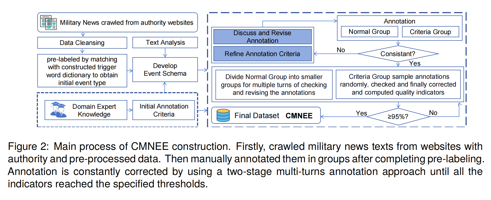
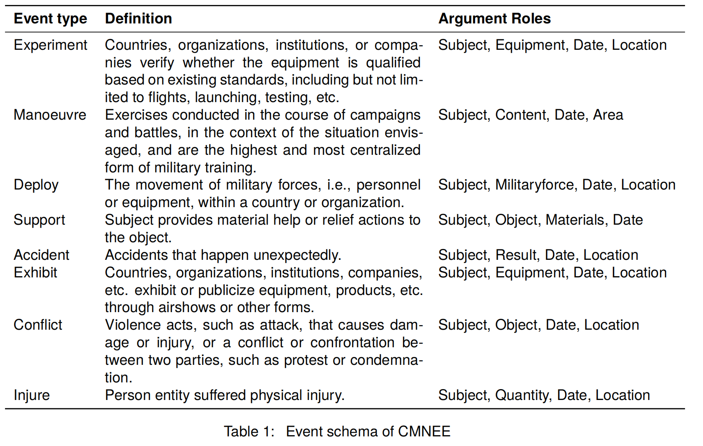
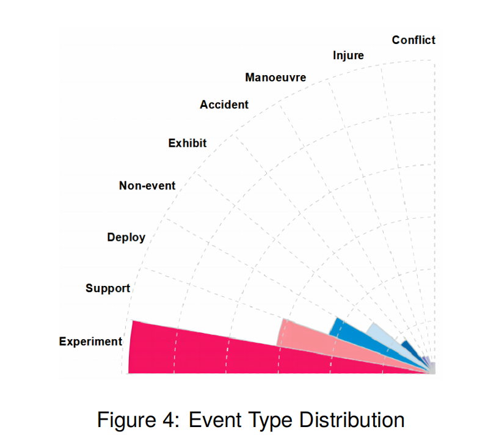
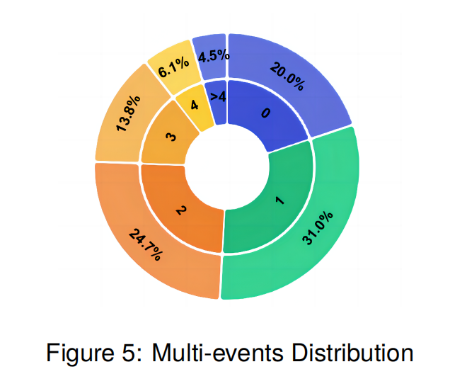
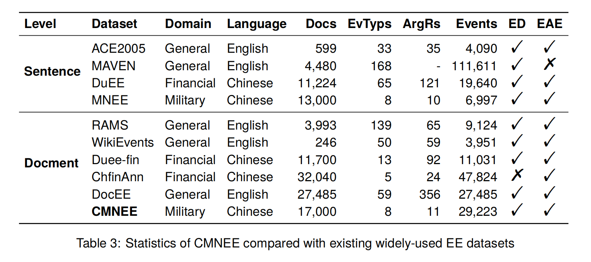
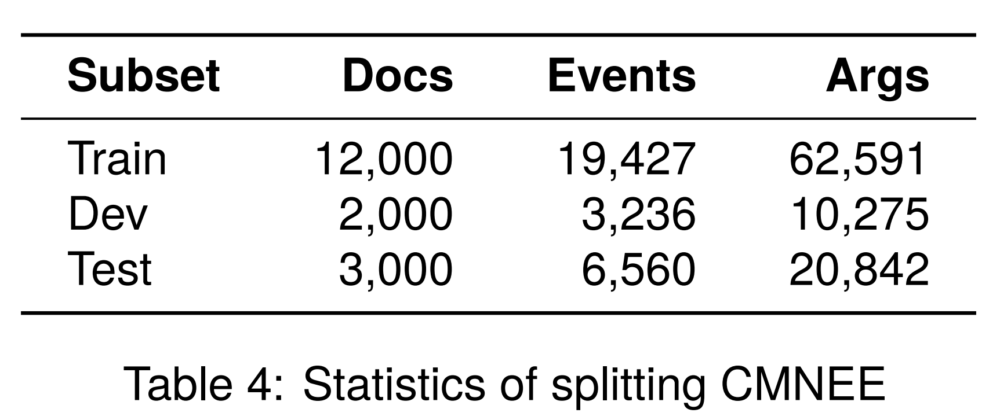
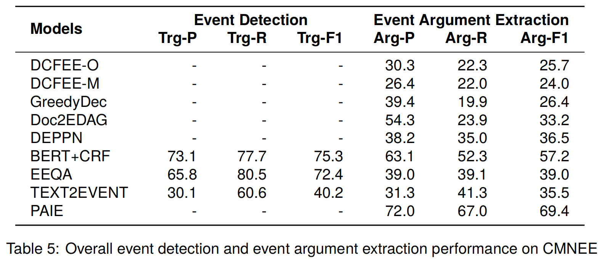
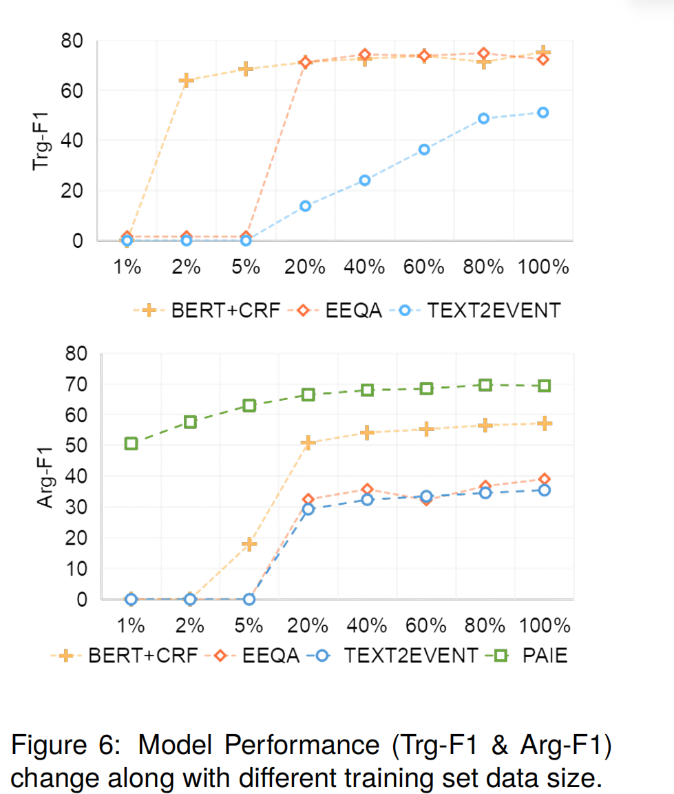

# CMNEE：基于开源中国军事新闻的大规模文档级事件抽取数据集

---

## 1. 摘要

本文面向军事领域事件抽取的数据稀缺问题，提出了大规模中文文档级军事新闻事件抽取数据集 CMNEE。数据集基于公开、权威的中文军事新闻构建，共包含 17,000 篇文档、29,223 个事件、93,348 个事件论元，定义了 8 类事件类型和 11 类论元角色，并额外标注了共指论元。

为保证数据质量，作者设计了“两阶段、多轮次”的纯人工标注流程，并以事件类型准确率、事件类型召回率、事件论元召回率和共指论元召回率四项指标进行质量评估，最终四项指标分别达到 **95.1%、96.4%、96.8% 和 97.2%**。

论文复现并评估了多类先进事件抽取模型。实验表明：现有模型在 CMNEE 上的表现明显低于其在其他领域数据集上的表现；触发词信息对军事事件抽取尤为重要；共指论元会显著影响评价结果；军事文本中的多事件、重叠事件、长论元、共享论元和类别不平衡，仍是文档级事件抽取需要解决的关键问题。

---

## 2. 研究背景

### 2.1 什么是事件抽取

事件抽取是从非结构化文本中抽取结构化事件知识的任务，通常包括两个子任务：

1. 事件检测（Event Detection，ED）：识别事件触发词并判断事件类型。
2. 事件论元抽取（Event Argument Extraction，EAE）：识别与事件相关的实体或文本片段，并判断其论元角色。

以论文中的军事新闻示例为例，一个文档中可能同时出现多个事件。模型不仅要识别“attack”“attacking”“deployed”“confrontation”等触发词及相应事件类型，还要抽取主体、客体、地点、日期和军事力量等论元。

### 2.2 军事事件抽取的价值

论文指出，从军事文本中提取结构化事件信息，是以下应用的基础：

- 情报分析；
- 决策辅助；
- 战略规划。

### 2.3 现有研究的不足

当前事件抽取研究主要集中在通用新闻和金融领域，军事领域研究相对较少。军事事件抽取面临以下问题：

- 深度神经网络模型高度依赖训练数据的规模与质量，而军事领域缺少高质量公开数据；
- 军事数据具有保密性和敏感性，公开信息有限；
- 军事领域事件模式的构建依赖专业知识，获取难度较高；
- 现有研究多基于句子级文本，难以处理跨句分布的事件论元；
- 军事事件数据主要依赖人工抽取，存在效率低、标准不一致和信息不完整等问题。

因此，构建面向军事领域的文档级事件抽取数据集具有重要的研究与应用价值。

---

## 3. 论文的主要贡献

1. 提出军事领域文档级事件抽取数据集 CMNEE。 数据集由 17,000 篇中文军事新闻文档构成，是论文所述当时唯一面向军事领域文档级事件抽取任务的数据集。
2. 构建军事事件模式。 数据集定义了 8 类事件类型和 11 类论元角色，同时标注触发词、事件类型、事件论元、论元角色和共指论元。
3. 设计两阶段、多轮次人工标注流程。 作者通过普通标注组与标准组协作、多轮检查和持续修订标注规范来保证质量。
4. 系统评估多类先进模型。 论文在 CMNEE 上复现了不使用触发词、使用触发词以及使用金标准触发词的多类模型，并分析数据规模、共指论元和错误类型带来的影响。

---

## 4. CMNEE 的构建过程

### 4.1 数据来源

数据主要来自具有权威性、相关性和领域价值的军事新闻网站，包括：

| 数据来源 | 占比 |
|---|---:|
| 环球网（Huanqiu） | 40% |
| 中国军网（China Military Online） | 32% |
| 新浪军事（Sina Military） | 25% |
| 百度百科（Baidu Encyclopedia） | 2% |
| 其他来源 | 1% |

### 4.2 数据采集与预处理

作者使用 Python 的 Requests 和 BeautifulSoup 库，从上述网站抓取了接近 100,000 条军事新闻数据，随后完成以下处理：

1. 以句子级军事事件检测数据集 MNEE 中预定义的 7 类事件为基础；
2. 使用 ChatGPT 为这些事件类型生成同义词和相关词；
3. 对生成结果进行人工筛选，形成关键词词典；
4. 用关键词词典匹配新闻文本，根据匹配词数量筛选出 30,000 条高相关数据；
5. 使用 Pandas 过滤缺失样本和重复样本；
6. 使用正则表达式删除乱码、网页 HTML 等无意义信息；
7. 最终保留 17,000 篇高质量新闻文档。

### 4.3 事件模式构建与预标注

作者沿用 MNEE 的基础设计，并结合以下信息构建事件模式：

- 对采集新闻的分析；
- 军事领域专家知识；
- 触发词词典匹配得到的预标注结果；
- 各事件类型在真实数据中的比例与分布。

作者先用触发词词典预标注文档中可能包含的事件类型，再根据预标注后的文档分析各事件类型对应的论元角色，最终形成 CMNEE 的事件模式。

### 4.4 两阶段、多轮次人工标注

#### 阶段一：并行标注与规范修订

标注人员分为两组：

- **普通组（Normal Group）**：由长期从事数据标注、具有部分背景知识的标注公司员工组成；
- **标准组（Criteria Group）**：由领域专家组成，具备较完整的专业知识，并参与标注规范制定。

全部数据被打乱并分批，两组人员同时进行标注。每批标注完成后，对结果进行检查；对存在分歧的标签及时讨论并修改，同时不断完善标注规范。

#### 阶段二：多轮复核与质量评估

普通组被进一步划分为多个小组，各小组依据最终标注规范，对阶段一的结果进行多轮检查和修订。标准组随机抽样检查，并在组内讨论后完成纠正和质量指标计算。

若抽样数据的全部质量指标均不低于 95%，数据集通过质量检查；否则普通组继续修订标注。

---

## 5. 事件模式

CMNEE 定义了 8 类事件类型和 11 类论元角色。

11 类论元角色为：Subject、Equipment、Date、Location、Content、Area、Militaryforce、Object、Materials、Result、Quantity。

---

## 6. 标注质量评估

作者设计了四类质量指标。

| 指标 | 缩写 | 计算方式 | 最终结果 |
|---|---|---|---:|
| 事件类型准确率 | TypeAcc | `(Cor_es / S) × 100%` | 95.1% |
| 事件类型召回率 | TypeR | `(Cor_e / Act_e) × 100%` | 96.4% |
| 事件论元召回率 | ArgR | `(Cor_a / Act_a) × 100%` | 96.8% |
| 共指论元召回率 | Co-refR | `(Cor_c / Act_c) × 100%` | 97.2% |

其中：

- `Cor_es`：所有事件均被正确标注的样本数；
- `S`：抽取检查的样本总数；
- `Cor_e`、`Cor_a`、`Cor_c`：样本中正确标注的事件、论元和共指论元数量；
- `Act_e`、`Act_a`、`Act_c`：样本中实际应标注的事件、论元和共指论元数量。

正确事件要求触发词、触发词偏移量和事件类型均正确；正确事件论元要求在事件类型正确的前提下，论元文本、角色和偏移量均正确。

---

## 7. 数据集统计与特征

### 7.1 总体统计

| 统计项 | 数值 |
|---|---:|
| 文档数 | 17,000 |
| 事件类型数 | 8 |
| 论元角色数 | 11 |
| 非空事件数 | 29,223 |
| 事件论元数 | 93,348 |
| 平均每篇文档字符数 | 330 |
| 平均每篇文档句子数 | 6.7 |
| 平均每篇文档事件数 | 1.8 |
| 平均每篇文档事件论元数 | 6.6 |
| 最长文档字符数 | 496 |
| 单篇文档最大句子数 | 17 |

论文中的 token 指中文字符。

### 7.2 事件类型分布

CMNEE 存在明显的长尾和类别不平衡现象，这与真实场景中的数据分布一致：

- Experiment 数量最多，共 13,027 个实例；
- Conflict 数量最少，共 477 个实例；
- 尽管分布不均衡，由于数据集总体规模较大且事件类型数量有限，各类型仍拥有接近 500 个或更多实例，数据稀疏影响相对有限。

事件类型分布对应论文图 4。

### 7.3 多事件分布

论文图 5 给出了每篇文档包含的事件数量分布：

| 单篇文档事件数 | 文档占比 |
|:--:|:--:|
| 0 | 20.0% |
| 1 | 31.0% |
| 2 | 24.7% |
| 3 | 13.8% |
| 4 | 6.1% |
| 多于 4 | 4.5% |

接近一半的文档包含两个或更多事件，约四分之一的文档包含三个或更多事件，因此 CMNEE 可用于多事件抽取研究。

### 7.4 重叠事件

CMNEE 中包含重叠事件的实例占 42%。论文将重叠事件概括为以下情形：

- 同一个词在同一文档中作为不同事件的触发词；
- 同一个论元在多个事件中承担不同角色；
- 同一个论元在同一事件中承担不同角色。

作为对比，论文提到 FewFC 中只有 18% 的实例包含重叠事件，而且 FewFC 基于句子进行标注。重叠事件容易引起事件信息混淆或遗漏，增加完整抽取的难度。

### 7.5 长论元

军事文本包含大量武器装备等专有名词，长论元比例较高。CMNEE 中长度超过 10 个中文字符的论元占比接近 17%，增加了论元抽取和边界识别难度。

### 7.6 共享论元

论文将“同时属于不同事件，且文本相同或位于同一共指论元子列表中的论元”定义为共享论元。CMNEE 包含 19,353 个共享论元，约为普通论元数量的五分之一。

共享论元可以揭示事件之间的关系。例如，两个事件共享日期论元时，往往表示它们同时发生。准确  抽取含共享论元的多个事件既困难又重要。

### 7.7 与已有数据集的比较

ED 表示事件检测，EAE 表示事件论元抽取。

CMNEE 的事件类型和论元角色数量相对较少，但基本覆盖军事领域的主要事件类型，在文档数和事件数方面与已有常用数据集具有可比性。

---

## 8. 实验设计

### 8.1 数据划分

作者使用贪心算法划分训练集、开发集和测试集，使各子集中的事件类型分布尽可能一致。划分结果见论文表 4。

### 8.2 基线模型

论文将基线模型分为三类。

#### 第一类：不使用触发词信息的中文文档级模型

- DCFEE-O / DCFEE-M：通过关键事件检测和事件表填充完成事件论元抽取；DCFEE-O 每个关键事件句只生成一条事件记录，DCFEE-M 尝试生成多个可能的论元组合。
- GreedyDec / Doc2EDAG：基于实体信息，将事件抽取转化为有向图路径扩展任务；GreedyDec 以贪心方式填充一条事件表记录。
- DEPPN：使用多粒度非自回归解码器，基于文档感知表示并行生成事件。

这类模型用于检验在 CMNEE 中标注和使用触发词信息的必要性。

#### 第二类：主流端到端事件抽取模型

- BERT+CRF：序列标注模型；
- EEQA：将事件抽取转化为自然问答任务；
- TEXT2EVENT：采用序列到结构生成范式，端到端地从文本中直接抽取事件。

这类模型用于验证 CMNEE 相对于其他数据集的独特挑战。

#### 第三类：使用金标准触发词的事件论元抽取模型

- PAIE：利用考虑论元交互的提示来抽取事件论元。

该模型用于突出事件抽取中解决错误传播问题的重要性。

### 8.3 评价指标

论文对事件检测和事件论元抽取分别报告微平均精确率（Precision）、召回率（Recall）和 F1 值：

- 事件检测：Trg-P、Trg-R、Trg-F1；
- 事件论元抽取：Arg-P、Arg-R、Arg-F1。

---

## 9. 实验结果

### 9.1 总体结果

### 9.2 结果分析

#### 发现一：CMNEE 具有明显挑战性

几乎所有模型在 CMNEE 上的性能都相对较低，说明军事领域事件抽取具有独特难点，仍需要进一步研究。

#### 发现二：触发词信息非常重要

不使用触发词信息的模型明显弱于使用触发词信息的模型。论文认为，军事事件通常围绕若干特定类型的实体展开，事件模式中的论元角色重叠程度高，仅依靠论元较难准确区分不同事件。加入事件触发词信息有助于完成军事事件抽取。

PAIE 使用金标准触发词，其事件论元抽取效果明显优于其他模型，Arg-F1 达到 69.4。

#### 发现三：BERT+CRF 表现突出

BERT+CRF 的事件检测 Trg-F1 达到 75.3，论元抽取 Arg-F1 达到 57.2。论文认为，这与 CRF 在建模多事件关联方面的优势有关。CMNEE 中多事件文档占比较高，CRF 有助于多事件信息抽取。

### 9.3 数据规模分析

作者从训练集中随机选择不同比例的文档，比较 BERT+CRF、EEQA、TEXT2EVENT 和 PAIE 的性能变化。论文图 6 表明：随着训练数据比例增加，模型的事件检测和事件论元抽取性能整体提升，CMNEE 的数据规模能够为模型提供较充分的训练。

### 9.4 共指论元分析

同一事件论元可能在文档中以相同文本、不同偏移量，或以简称、代号等形式多次出现。只依据事件列表判断抽取结果，可能无法满足实际应用需求。

论文以“海豹号核潜艇”和“海豹号”为例：两者都可以作为同一试验事件的 Equipment 论元。如果评价时考虑共指论元，事件论元抽取性能会明显提高。论文图 7 展示了转换后的评价结果。

---

## 10. 错误分析

作者随机抽取 50 个样本，对事件检测和事件论元抽取错误进行分析，将错误归纳为三类。

### 10.1 识别错误：接近 50%

这是最常见的错误，包括：

- 将负例错误分类为某个正事件类型，即假阳性（FP）；
- 将正例错误分类为 N/A，即假阴性（FN）。

这表明，在复杂文本中准确理解事件语义仍然困难。

### 10.2 多数类偏置：约 20%

CMNEE 存在天然的类别不平衡。在处理复杂文本时，模型倾向于将实例分类为高频事件类型。

作者在构建 CMNEE 时没有采用数据增强或类别平衡方法，而是保留真实世界的数据分布。论文希望后续模型能够更好地处理类别不平衡，并提高少样本事件类型的抽取效率。

### 10.3 抽取边界错误：约 32%

模型抽取的论元 token 多于或少于标注论元。例如：

- 正确的 Deploy 事件 Equipment 论元应为完整的“SAD 反导系统”，模型只抽取了“反导系统”，遗漏关键信息；
- Location 论元应为“韩国”，而不是“位于韩国”，后者引入了无关信息。

如何准确确定论元边界，使抽取结果简洁、有效，是模型性能不理想的重要原因之一。

---

## 11. 相关工作定位

### 11.1 现有事件抽取数据集

论文指出，已有数据集面向不同子任务和文本粒度：

- ACE2005 是广泛使用的事件抽取数据集；
- MAVEN 是大规模通用领域事件检测数据集；
- RAMS 和 WikiEvents 常用于文档级事件抽取；
- ChfinAnn 使用远程监督辅助构建，规模较大，但不包含事件触发词，只能用于事件论元抽取；
- 现有数据集主要面向通用领域或金融领域，也有生物医学、文学、恐怖袭击和突发新闻等特定领域数据集。

论文认为，当时没有公开的、专门面向军事领域事件抽取任务的英文数据集。ACE2005、MAVEN 和 MUC-4 虽然包含部分军事相关事件，但相关数据量有限，也不便于开展专门研究。

### 11.2 大语言模型辅助标注

已有研究尝试使用 ChatGPT 等大语言模型辅助命名实体识别和关系抽取标注。但事件抽取的数据结构更加复杂，论文团队的尝试结果并不理想，能够节约的人力、时间和成本也较有限。

由于 CMNEE 是军事领域的先行数据集，作者优先考虑数据的真实性、可靠性和质量，最终选择纯人工标注。同时，论文认为使用新技术辅助标注仍是值得继续研究的方向。

---

## 12. 数据集的局限性

论文明确指出 CMNEE 存在两方面局限。

### 12.1 事件类型和论元角色有限

军事领域具有保密性和敏感性，公开信息有限；事件模式和标注规范又高度依赖不易获得的领域专家知识。因此，CMNEE 最终只定义了 8 类较常见、适合公开研究的事件类型。

作者希望未来邀请更多权威专家，增加并完善事件类型，提高数据集的多样性、适用性和影响力。

### 12.2 语言和标注方法有限

CMNEE 规模较大，且采用文档级标注，标注信息复杂。两阶段、多轮次流程虽然提高了效率并保证了质量，但时间、人力和费用成本仍然很高。

作者目前只标注中文语料，一方面源于标注成本，另一方面是因为中文事件抽取本身拥有较大且活跃的研究社区。未来有必要将 CMNEE 扩展到其他语言，并继续探索新技术辅助标注。

---

## 13. 结论

CMNEE 填补了军事事件抽取与主流事件抽取研究之间的数据缺口，是现有事件抽取数据集的重要补充。与其他数据集相比，它具有以下突出特点：

- 面向中文军事领域；
- 采用文档级标注；
- 多事件和重叠事件比例较高；
- 长论元和共享论元较多；
- 标注共指论元，使评价更符合实际抽取需求；
- 保留真实世界的长尾和类别不平衡分布。

实验结果说明，CMNEE 对现有模型具有较大挑战，军事领域事件抽取仍是一个开放问题。触发词建模、跨句论元识别、共指论元处理、多事件关联、长论元边界识别和类别不平衡，是后续研究值得重点关注的方向。
