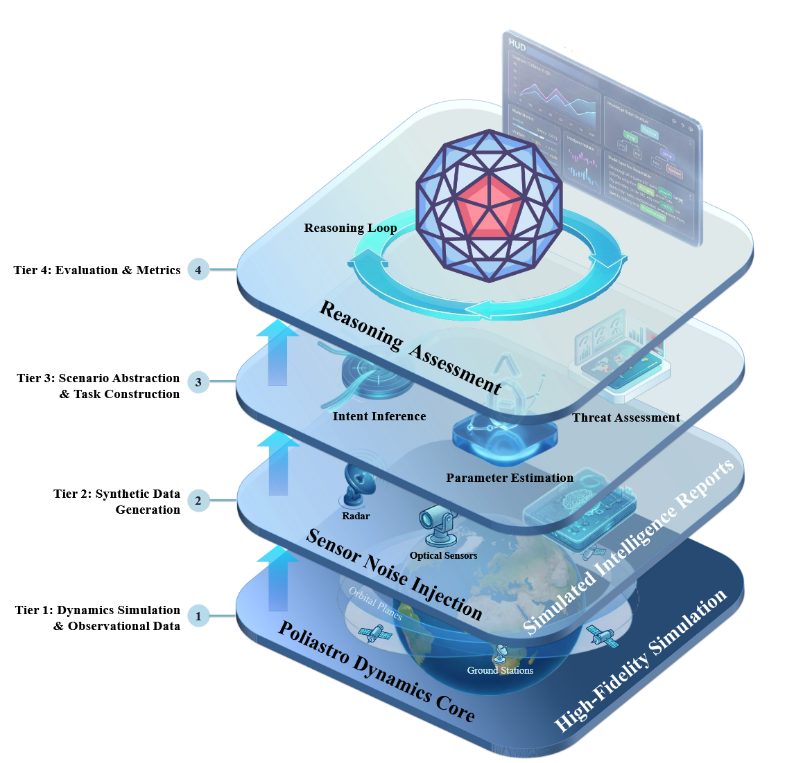
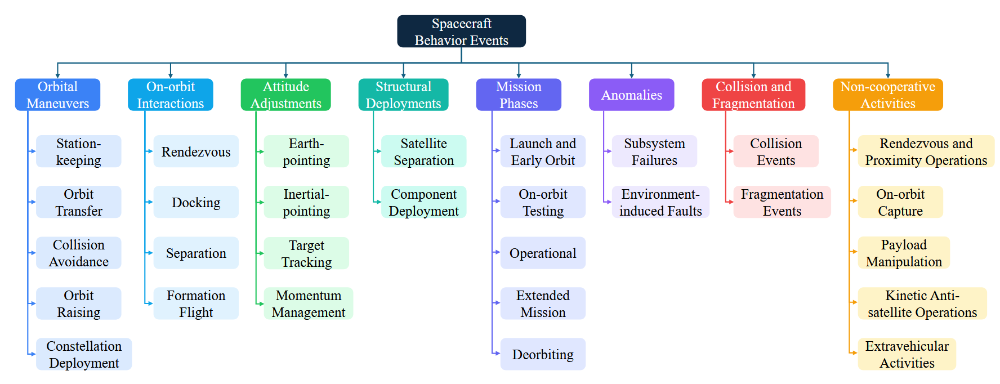
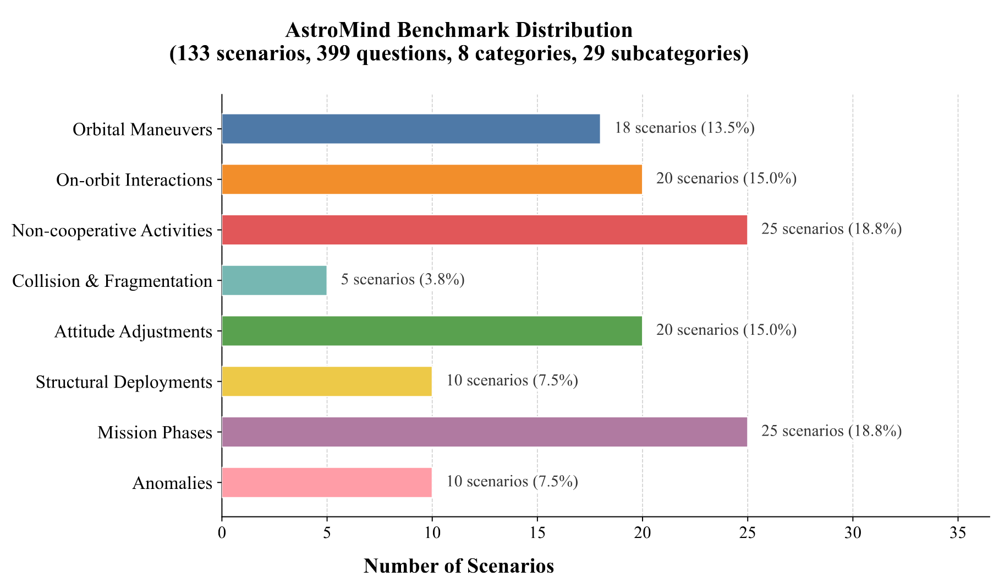
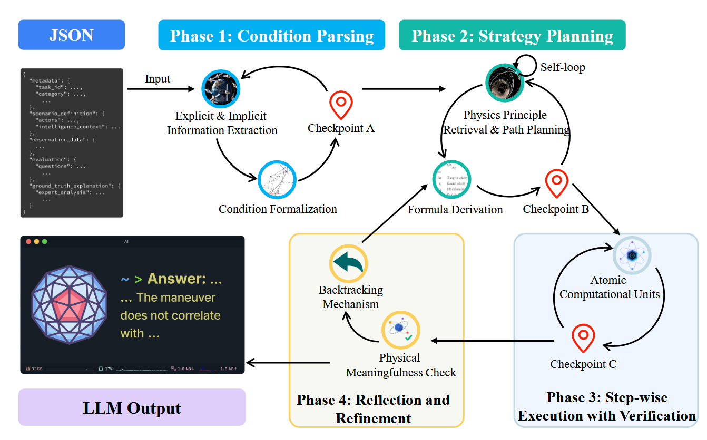
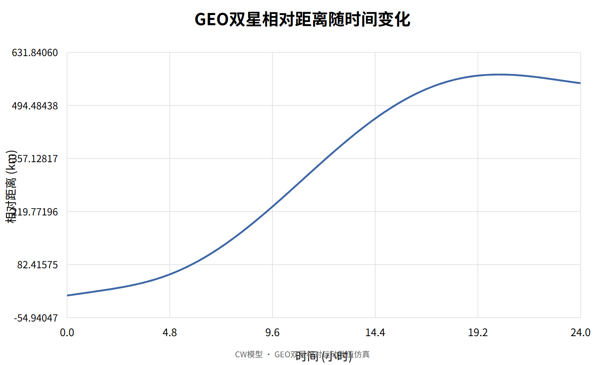
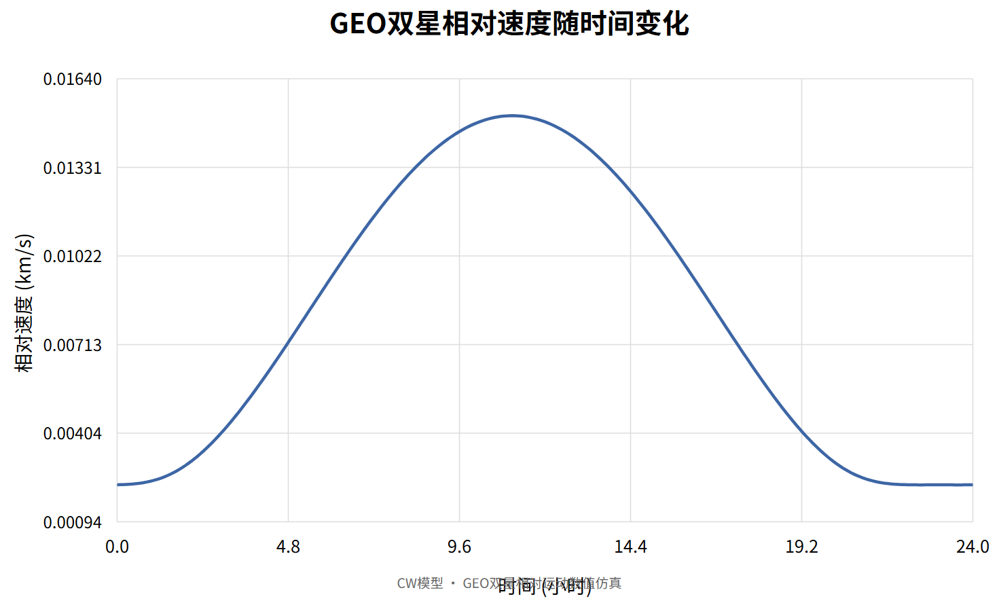
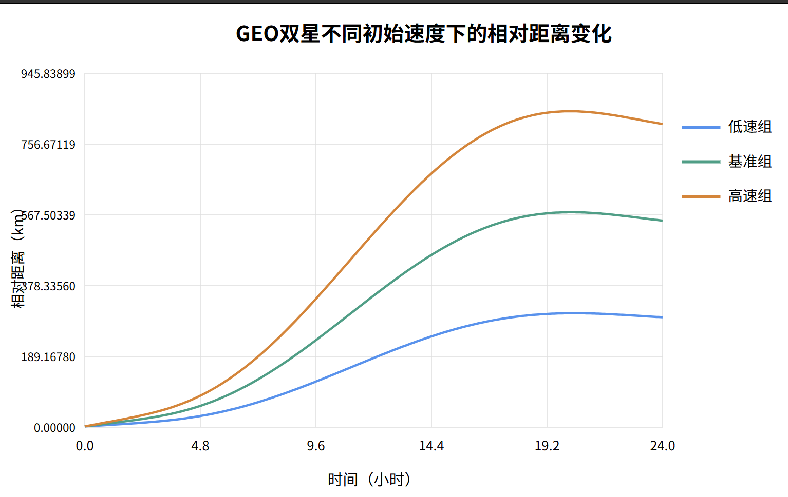
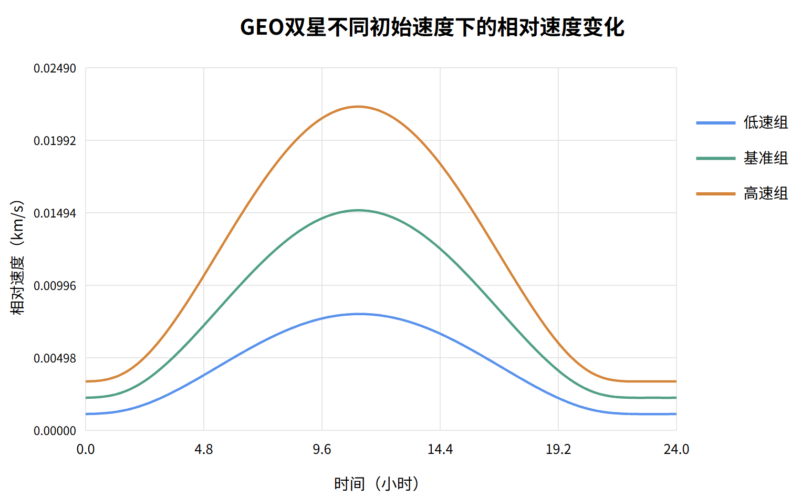
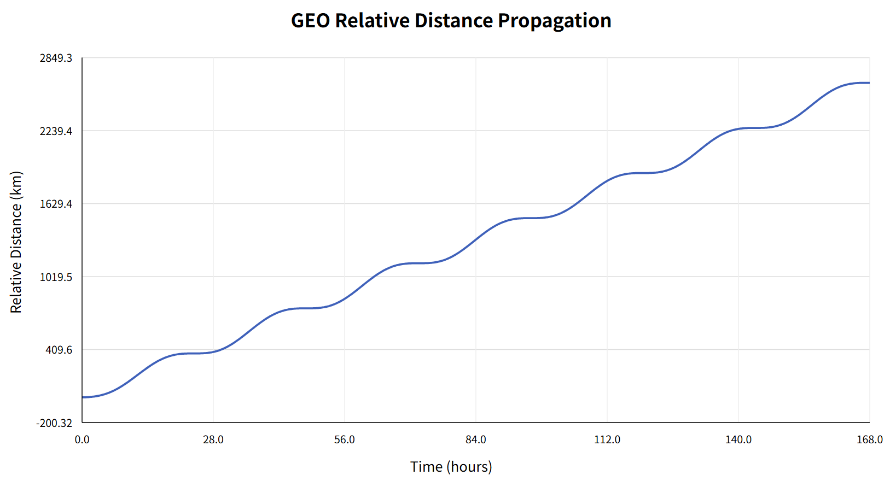
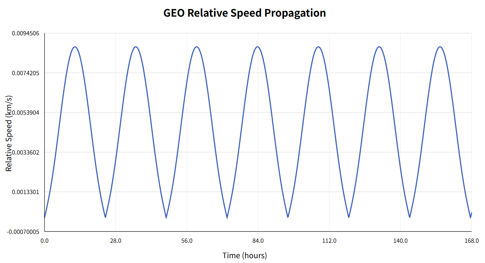

# AstroMind: A High-Fidelity Benchmark for Spacecraft Behavior Reasoning Based on Large Language Models（Astromind：基于大型语言模型的航天器行为推理的高保真基准。）

## 一、主要研究内容

  这篇论文研究的是：如何让大语言模型结合卫星轨道数据、轨道动力学知识和文字情报，分析航天器实施机动的原因，并进一步判断其行为意图和潜在威胁。论文最重要的特点是：把轨道力学的物理约束与大语言模型的语义推理结合起来。

## 二、研究背景

  传统的轨道监测技术可以通过轨道参数变化发现卫星发生了机动。
• 半长轴发生变化；
• 轨道偏心率发生变化；
• 轨道倾角发生变化；
• 速度发生变化。
  但是，发现机动不等于理解机动。例如，两颗卫星都发生了速度变化，仅仅根据速度变化，无法直接确定它们的行为目的。这篇文章想解决的问题就是从传统的机动检测，进一步发展到航天器行为理解和意图推理。

## 三、主要研究内容

#### 任务一：Intent Inference：行为意图推断

输入卫星的轨道变化、观测数据和任务背景，判断卫星为什么进行机动。

例如：轨道维持、轨道转移、交会准备、近距离检查等。

#### 任务二、Maneuver Parameter Estimation：机动参数估计

不仅判断卫星做了什么，还需要估计机动的物理参数。

例如：

- 速度增量 Δv；
- 机动方向；
- 机动幅度

#### 任务三、Threat Assessment：威胁评估

结合机动行为、卫星关系和辅助情报，判断行为的潜在威胁程度。论文采用低、中、高三个威胁等级。

## 四、如何构建整个模型框架

论文构建了一套完整的基准数据生成和模型评估体系。主要分为四个层次：

### 1.Tier 1：轨道动力学仿真与真实观测数据

首先需要解决一个问题：怎样获得可信的卫星轨道运动数据？论文使用了轨道动力学仿真工具 **Poliastro 0.17**。

主要采用：

- Cowell 方法：用于轨道运动数值传播。
- Runge-Kutta 积分：进行数值求解。
- \(J_2\) 摄动：考虑地球非球形引力影响。
- 大气阻力模型：模拟大气阻力影响。
- Impulsive Maneuver：模拟瞬时轨道机动。

同时，作者引入真实地面观测数据，包括方位角和高度角时间序列，对仿真轨迹进行约束和调整。

最终生成的数据包括：

|       数据       |     含义     |
| :--------------: | :----------: |
|      时间戳      | 卫星观测时间 |
| 位置向量\(r(t)\) | 卫星空间位置 |
| 速度向量\(v(t)\) | 卫星运动速度 |
|     半长轴a      |   轨道大小   |
|     偏心率e      |   轨道形状   |
|    轨道倾角i     | 轨道平面方向 |
|   升交点赤经等   | 其他轨道参数 |

  论文中的卫星轨道数据先通过物理模型生成具有真实物理意义的轨道运动，再利用实际观测约束数据。这样就能保证后续大模型推理具有物理依据

### 2. Tier 2：合成数据生成

为了让模型学习和判断不同类型的航天器行为，作者建立了一个行为分类体系。

8种一级行为类别

- 轨道机动
- 在轨交互
- 非合作活动
- 碰撞与碎片
- 姿态调整
- 结构部署
- 任务阶段
- 异常事件

29种二级行为类别，进一步细分具体行为，例如轨道转移、轨道维持、交会、对接、编队飞行和反卫星活动等

最终数据集的规模是：

另外，论文中还做了一件很重要的事情：模拟真实环境中的不确定性。实际卫星监测并不是每次都能获得完整、准确的数据。例如：
- 传感器会产生测量噪声。
- 某些时间段可能没有卫星观测数据。
- 不同观测设备的测量精度不同。
- 不同来源的文字情报可能相互矛盾。

因此，作者向数据中加入了三类观测误差：

1. 高斯白噪声。
2. 与天顶角有关的大气折射系统偏差。
3. 观测时间抖动。

此外，还给每个场景加入不同来源的文字情报，例如：

- 卫星任务公告；
- 轨道异常报告；
- 技术分析报告；
- 新闻报道；
- 社交媒体消息。

而且，这些情报具有不同的可信度，有些甚至故意设置为模糊或相互矛盾。这一步的意义：让大模型学会综合证据，而不是简单地从某一句话中寻找答案。

### 3.Tier 3：场景构建与任务输入

论文把前面生成的轨道数据和文字情报整理成结构化输入。

每个输入包含四部分：

| 输入组成              | 具体内容                     |
| --------------------- | ---------------------------- |
| Background            | 卫星身份、任务背景、时空环境 |
| Observation Data      | 轨道参数、位置、速度等       |
| Auxiliary Information | 多来源文字情报               |
| Question              | 需要大模型回答的问题         |

作者使用 JSON 格式组织数据。这样做的好处是，大模型既能看到数值轨道信息，也能看到文字情报。它需要结合两种信息进行推理，而不是只依赖其中一种。

### 4. Tier 4：模型评估与结果验证

论文设计了三类评价指标：

| 评价维度       | 评价内容                   |
| -------------- | -------------------------- |
| 行为识别准确率 | 判断行为是否正确           |
| 参数相对误差   | 估计的 Δv 与真实值相差多少 |
| 推理质量       | 逻辑、物理正确性、完整性   |

其中，推理质量采用 5 分制，分别评价：

1. Logical Coherence：逻辑连贯性。
2. Physical Soundness：物理正确性。
3. Reasoning Completeness：推理完整性。

此外，文章提出了一个评价方法：HSNE（Hybrid Semantic-Numeric Evaluation，混合语义与数值评价）

它分为三个阶段：

这样就避免了完全依赖另一个大模型来判断数值计算是否正确

## 五.创新：Reasoning Loop

前面四层是数据生成和评估框架。文章专门设计了一种结构化推理方法，叫作：
Reasoning Loop（推理循环）。

传统大模型通常采用直接提问的方式：输入数据 → 大模型 → 输出答案。
作者认为这种方式存在一个问题：模型可能会给出听起来很合理的答案，但中间计算过程存在错误，甚至违反轨道力学规律。因此设计了四个阶段。

**Phase 1：Condition Parsing（条件解析）**

提取输入中的所有条件。例如：轨道半长轴、偏心率、速度变化、观测时间等。

目的：避免遗漏重要信息。

**Phase 2：Strategy Planning（策略规划）**

  根据任务确定应该使用哪些物理公式和分析方法。例如：确定是否使用活力公式、轨道要素变化分析等。

  目的：先确定正确的解题路线，再进行计算。

**Phase 3：Step-wise Execution（逐步执行与验证）**

按照既定步骤进行计算，每一步都检查数值和单位。例如：检查速度增量的单位是否为 m/s。

目的：减少中间计算错误。

**Phase 4：Reflection and Refinement（反思与修正）**

检查最终结果是否符合物理规律。如果发现机动参数明显不合理，就返回前面的步骤重新检查假设或计算。

普通 Chain of Thought 主要强调逐步推理，而 Reasoning Loop 进一步强调：
推理 → 检查 → 发现错误 → 返回修正 → 得到结果。

## 六. 对比

### 一、论文基本信息与研究目标

| 对比维度 | 第一篇：高轨空间目标意图识别            | 第二篇：AstroMind                              |
| -------- | --------------------------------------- | ---------------------------------------------- |
| 研究方向 | 高轨空间目标意图识别                    | 航天器行为推理与评估                           |
| 研究对象 | GEO 附近的高轨空间目标                  | 多种航天器行为场景                             |
| 核心目标 | 让大模型理解目标行为并推断任务意图      | 建立高保真 Benchmark，评估大模型的行为推理能力 |
| 主要问题 | 如何从轨道观测数据识别目标意图          | 如何让大模型可靠地理解、推理和评价航天器行为   |
| 研究性质 | 意图识别方法与 Agent 系统设计           | 数据集构建、推理方法与模型评测                 |
| 核心贡献 | 构建 LLM Agent 与专业工具协同的识别框架 | 构建行为推理基准和 Reasoning Loop 方法         |

### 二、模型架构与核心技术

| 对比维度 | 第一篇                                     | 第二篇                                 |
| -------- | ------------------------------------------ | -------------------------------------- |
| 核心模型 | 大语言模型 Agent                           | 多种大语言模型                         |
| 核心机制 | ReAct                                      | Reasoning Loop                         |
| 主要技术 | Prompt Engineering、工具调用、专业知识融合 | 条件解析、策略规划、逐步执行、反思修正 |
| 工具调用 | 重点使用专业工具                           | 重点研究结构化推理与评估               |
| 行为识别 | Random Forest 随机森林                     | 大模型进行行为推理                     |
| 轨道计算 | HPOP 轨道预测、相对运动分析                | 轨道动力学仿真与物理约束               |
| 数值计算 | 交给专业计算工具                           | 结合数值计算与语义评价                 |
| 推理方式 | 思考—行动—观察                             | 解析—规划—执行—反思                    |
| 输出结果 | 行为类别、意图类别、推理依据、置信度       | 行为判断、机动参数、威胁等级及推理结果 |

### 三、两篇论文的核心区别总结

| 比较角度         | 第一篇                                    | 第二篇                                       |
| ---------------- | ----------------------------------------- | -------------------------------------------- |
| 研究重点         | 如何构建意图识别 Agent                    | 如何评价和提升行为推理能力                   |
| 核心创新         | 大模型与专业工具协同                      | 高保真 Benchmark 与闭环推理                  |
| 更强调什么       | 工程应用与任务执行                        | 推理可靠性与综合评估                         |
| 解决的关键问题   | 从轨道数据到意图识别                      | 从多源证据到可靠行为推理                     |
| 适合借鉴的内容   | Agent 架构、ReAct、随机森林、轨道计算工具 | Reasoning Loop、多源信息融合、物理约束、HSNE |
| 对后续研究的价值 | 提供完整的高轨意图识别系统基础            | 提供推理改进和实验评价方法                   |

第一篇：构建意图识别系统
解决如何利用轨道数据、专业工具和大模型识别高轨目标意图的问题。

第二篇：改进推理与评价方法
解决如何让模型进行更可靠的物理推理，以及如何全面评价模型能力的问题。

# 已完成工作

1. **Agent 基础框架搭建**

目前已经完成 GEO_LLM_Agent 项目的基础框架搭建。

2. **GEO 卫星场景数据生成与验证**

为了验证现有轨道计算和特征提取模块，首先构建了一个 GEO 卫星悬停场景。

3. **运动特征提取与文本化处理**

在生成轨迹数据后，进一步实现了运动特征提取。

4. **Qwen3-32B 本地大模型部署**

目前已经下载 Qwen3-32B-AWQ 模型，并在实验室服务器上使用 vLLM 部署本地推理服务。

- 研究目标卫星与参考卫星之间的相对距离如何随时间变化。
- 判断两颗卫星是在逐渐接近、逐渐远离，还是保持稳定距离。
- 为判断接近监视、伴飞等行为提供距离特征。

- 研究两颗卫星之间的相对速度变化。
- 判断相对运动是否剧烈、是否趋于稳定。
- 为分析卫星是否具有持续接近或相对运动特征提供依据。

- 改变初始相对速度。
- 观察不同初始速度条件下，相对距离如何变化。
- 分析初始速度对卫星相对距离演化的影响。

改变初始相对速度。
• 比较不同条件下的相对速度变化。
• 分析初始速度扰动对后续运动状态的影响。

- 展示 GEO 场景下卫星相对距离的变化。
- 分析 GEO 卫星相对位置关系。
-  为后续 GEO 卫星行为分析提供距离数据基础。

- 展示 GEO 场景下卫星相对速度的变化。
- 分析 GEO 场景中的相对运动状态。
- 为 GEO 卫星行为特征提取提供速度数据基础。

# 下一步计划：

让真实的 Qwen3-32B 接管 ReActAgent，使它能够自主决定调用哪个专业工具，并根据工具返回结果完成卫星行为与意图分析。