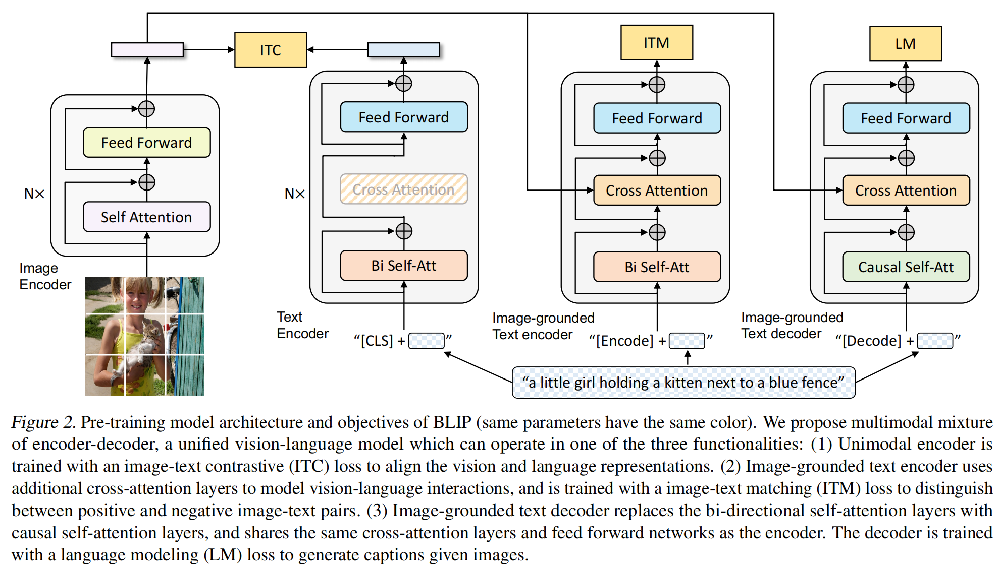
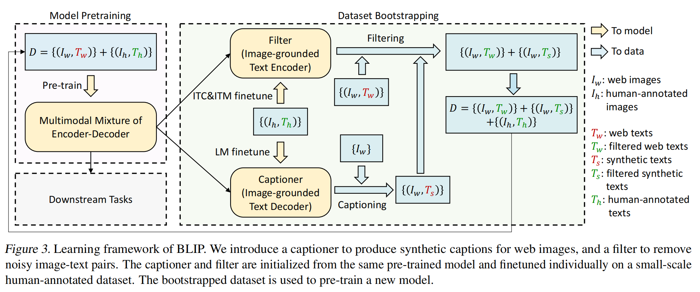
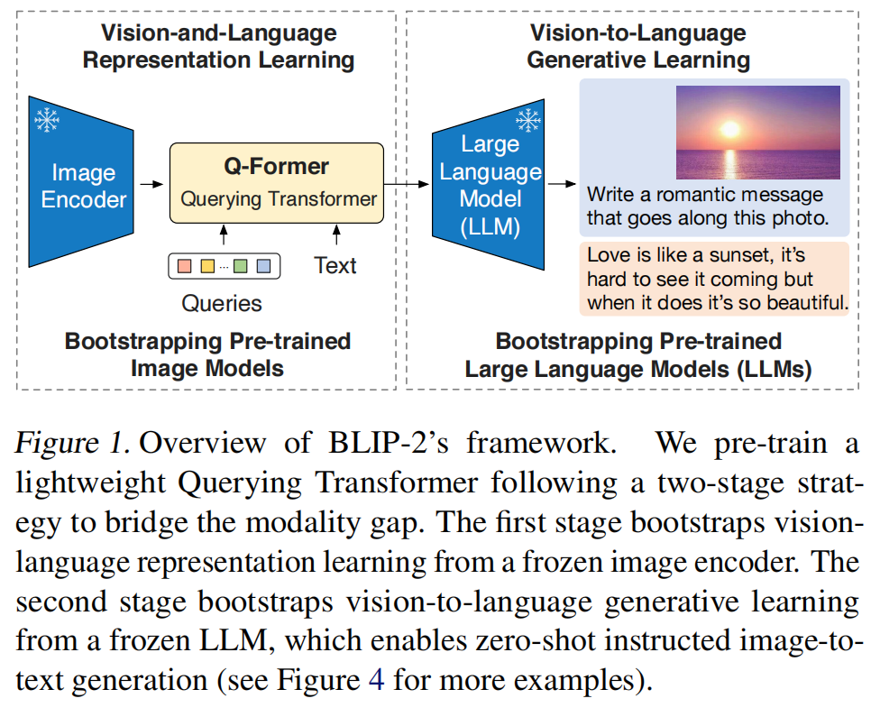
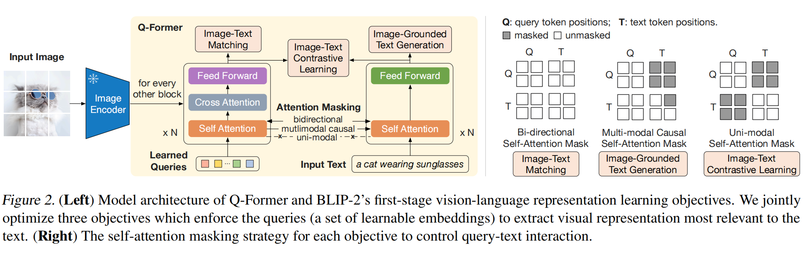
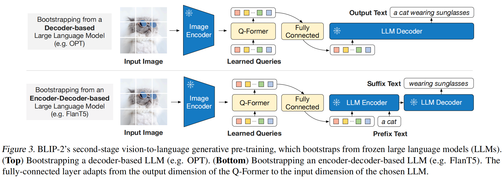
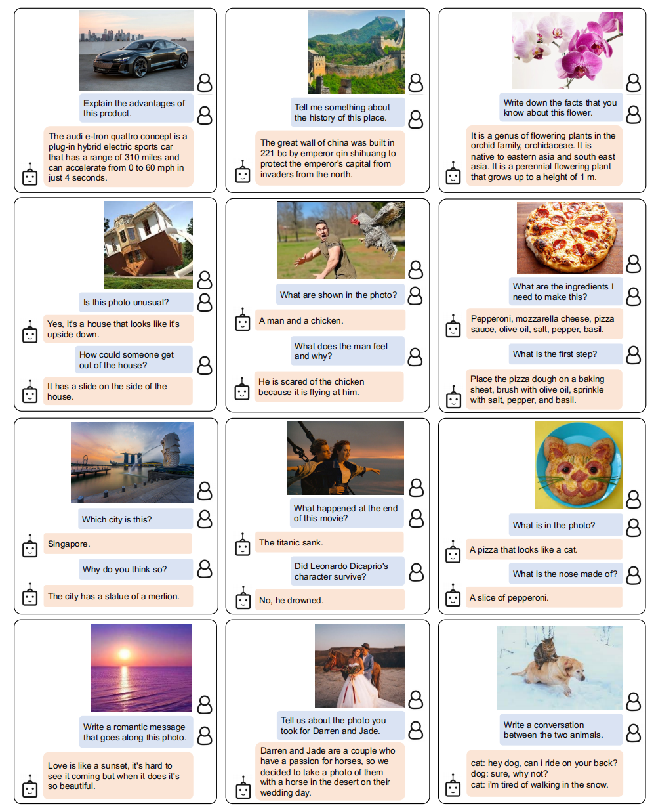
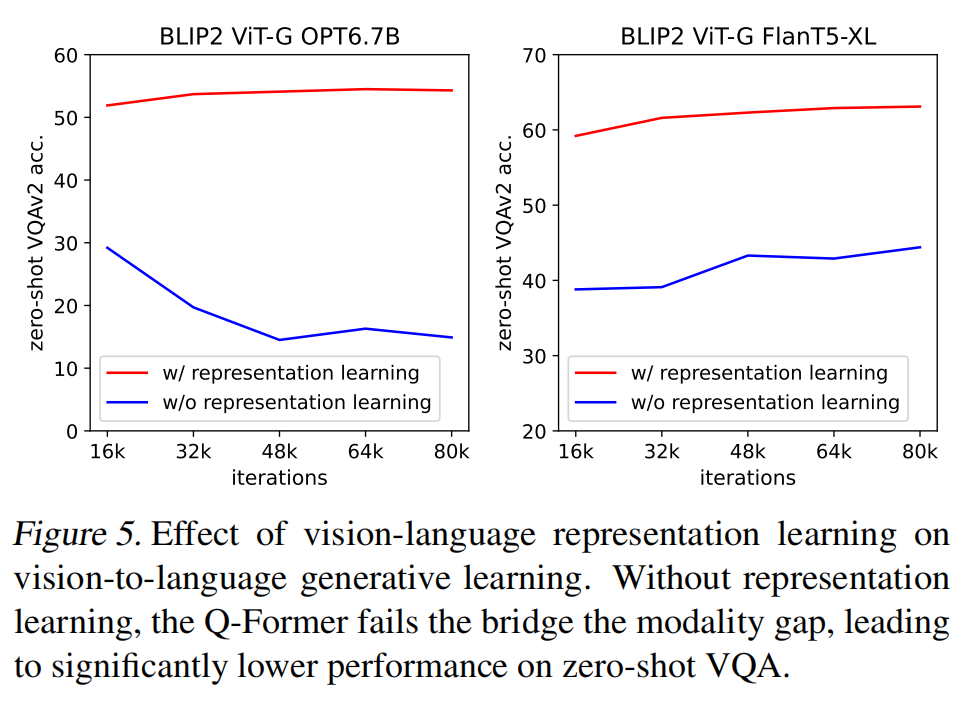

# Vision-Language Pre-training 已更新文献数量 2 篇（BLIP 系列）

## 2篇 - Junnan Li（Keywords: Vision-Language Pre-training, Caption Bootstrapping, Q-Former, Frozen LLM）

- 主要作者单位：Salesforce Research
- 论文关系：BLIP 先解决“一个模型兼顾理解与生成、如何用好噪声图文对”；BLIP-2 进一步解决“如何低成本接入已经训练好的视觉编码器与大语言模型”。
- 阅读时间：2026/09/28

---

### 1. BLIP: Bootstrapping Language-Image Pre-training for Unified Vision-Language Understanding and Generation（ICML 2022）[[本地论文](./Blip.pdf)] [[代码](https://github.com/salesforce/BLIP)]

BLIP 做了两件事：模型上用 **MED（Multimodal Mixture of Encoder-Decoder）** 把图文理解与文本生成统一到一套参数里；数据上用 **CapFilt（Captioning and Filtering）** 给网页图片重新写描述、再过滤噪声。论文用一组完整消融证明：网页图文数据不是越多越好，合成文本也不是越“稳妥”越好，数据质量和描述多样性会直接影响视觉语言预训练。

#### 1.1 研究背景与问题

两个短板。

第一是模型结构割裂。以 CLIP、ALBEF 为代表的编码器模型适合检索、匹配等理解任务，但不能自然地做图像描述生成；以统一 Encoder-Decoder 为主的生成模型虽然能输出文本，在图文检索上又不够强。即，同一套模型通常只能偏向“理解”或“生成”一侧。

第二是训练数据有噪声。大规模 VLP 基本依赖从网页抓取的 image-alt-text 对，但网页文字通常并没有描述图像本身。以往工作主要依靠扩大数据量掩盖这一问题，BLIP 则直接处理 caption 的质量。

论文希望得到一个统一框架，同时覆盖图文检索、图像描述、VQA、视觉推理、视觉对话，并能从噪声网页数据中获得更有效的监督。

#### 1.2 MED：一套参数，三种工作模式

图 2 是 BLIP 的核心结构。视觉侧采用 ViT，把图像切成 patch 并输出视觉 token；文本侧以 BERT-base 初始化，通过改变注意力结构和输入标记，在三种模式之间切换：

1. **Unimodal encoder（单模态编码器）**：图像和文本分别编码，用于全局对齐。文本开头加入 `[CLS]`，其输出作为句子表示。
2. **Image-grounded text encoder（图像条件文本编码器）**：在文本 Transformer 的每个 block 中插入 Cross-Attention，让文本查询图像特征；开头使用 `[Encode]`，对应输出作为图文对的联合表示。
3. **Image-grounded text decoder（图像条件文本解码器）**：把双向 Self-Attention 换成因果 Self-Attention，自回归生成 caption；开头使用 `[Decode]`。

三种模式对应三项联合优化目标：

- **ITC（Image-Text Contrastive Loss）**：拉近正样本图文表示，拉远负样本。论文沿用 ALBEF 的 momentum encoder 和软标签，以减轻“批内负样本其实语义相近”的问题。
- **ITM（Image-Text Matching Loss）**：二分类判断图文是否匹配，学习细粒度跨模态交互；负样本通过 hard negative mining 选择，即相似度越高、越容易混淆的负对越有机会参与训练。
- **LM（Language Modeling Loss）**：给定图像自回归生成文字，采用交叉熵并使用 0.1 label smoothing。作者特别强调，相比常见的 MLM，LM 更直接地训练“把视觉信息组织成连贯文本”的能力。

参数共享也不是简单地把编码器和解码器完全合并。二者共享 embedding、Cross-Attention 和 FFN，但 **不共享 Self-Attention**

#### 1.3 CapFilt：先生成，再过滤，再从头训练

CapFilt 的流程不是“直接拿当前模型继续训练”，而是一个教师生成数据、学生重新预训练的过程：

1. 先用原始图文数据预训练 MED。
2. 从同一个 MED 初始化两个独立模块，并在 COCO 小规模人工标注数据上微调：Captioner 使用 LM，Filter 使用 ITC+ITM。
3. Captioner 为每张网页图片生成一条合成描述；Filter 同时检查原网页文本和合成文本，ITM 判断为不匹配的文本被删除。
4. 把过滤后的网页文本、过滤后的合成文本与人工标注数据合并，形成新训练集。
5. 用新数据集重新预训练一个模型。

#### 1.4 主要结果

BLIP 最值得借鉴的不是某个单独模块，而是“模型结构与数据闭环一起设计”：MED 既能当 Captioner，也能当 Filter；二者反过来改善下一轮训练数据。论文的实验链条比较完整——单独生成、单独过滤、二者结合、生成策略、参数共享、训练时长、是否从头训练都做了对照。

局限性：CapFilt 需要先训练教师，再生成和筛选大规模 caption，流水线并不轻；Filter 的判断仍受 COCO 域和教师能力限制；视频任务只是逐帧拼接，不能建模动作顺序。

---

### 2. BLIP-2: Bootstrapping Language-Image Pre-training with Frozen Image Encoders and Large Language Models（ICML 2023）[[本地论文](./Blip2.pdf)] [[代码](https://github.com/salesforce/LAVIS/tree/main/projects/blip2)]

BLIP-2 不再从头联合训练一个庞大的视觉语言模型，而是冻结现成的图像编码器和 LLM，只训练中间的 **Q-Former** 与线性投影层。Q-Former 用固定数量的查询从视觉 token 中“捞取”与语言有关的信息，第一阶段先学图文对齐，第二阶段再把这些信息变成 LLM 能理解的软提示。核心贡献不是简单的“视觉接 LLM”，而是证明了在冻结两端的条件下，先做表征对齐、再做生成对齐 比只靠生成损失稳定得多。

#### 2.1 为什么还需要 BLIP-2

BLIP 仍然需要端到端训练视觉与文本模块。随着 ViT 和 LLM 规模增大，这种训练越来越昂贵，也难以及时复用视觉、语言两个领域已经训练好的单模态模型。BLIP-2 的基本假设是：冻结模型已经分别具备高质量视觉表示和强语言生成能力，真正缺的是一个把二者对齐的轻量接口。

冻结两端也让问题更难。LLM 在语言预训练中没见过图像，而它的权重又不能改；仅靠“给图生成文本”的 LM loss，视觉特征未必能稳定进入 LLM 的语义空间。作者因此把对齐拆成两个阶段，并让 Q-Former 同时承担信息瓶颈与模态适配器的角色。

#### 2.2 Q-Former 的结构

Q-Former 包含两个共享 Self-Attention 的 Transformer 子模块：

- image transformer 接收一组可学习 query，并通过隔层插入的 Cross-Attention 读取冻结图像编码器的输出；
- text transformer 既可做文本编码器，也可做文本解码器；query 与文本 token 能否互看，由不同任务的 attention mask 控制。

Q-Former 从 BERT-base 初始化，Cross-Attention 随机初始化，总计 188M 参数。实验使用 32 个 query，每个维度 768，输出记为 `Z`，因此固定为 32×768。相比 ViT-L/14 的 257×1024 图像特征，这个表示明显更小；不论输入图像分辨率如何，传给后续 LLM 的视觉 token 数都是固定的 32 个。这既控制了计算量，也强迫 query 只保留与文本最相关的信息。

#### 2.3 第一阶段：从冻结图像编码器学习视觉语言表征

第一阶段沿用 BLIP 中经过验证的三类目标，但全部围绕 query 设计：

1. **ITC**：query 输出 `Z` 中有 32 个向量。模型分别计算每个 query 与文本 `[CLS]` 表示的相似度，取最大值作为图文相似度，再做对比学习。为避免信息泄漏，query 与文本在该目标下互不可见。由于图像编码器冻结，单卡能容纳更多样本，因此直接使用 in-batch negatives，不再需要 BLIP 的 momentum queue。
2. **ITG**：query 能看图像但不能看文本，文本 token 能看全部 query 和此前文本 token。若要生成 caption，视觉信息必须先经 query 压缩，再从 query 传给文本，因此 ITG 会逼迫 query 提取足够的语言相关视觉内容。解码任务以 `[DEC]` 开始。
3. **ITM**：query 与文本使用双向注意力充分交互，每个 query 输出经过二分类头，再对全部 query 的 logits 求平均，判断图文是否匹配；负样本仍采用 hard negative mining。

这里的注意力掩码不是实现细节，而是让同一个 Q-Former 在“独立对齐、条件生成、细粒度融合”三种训练信号之间复用参数的关键。

#### 2.4 第二阶段：把视觉表示接入冻结 LLM

第一阶段完成后，Q-Former 已经会抽取与文本相关的视觉信息。第二阶段用一个全连接层把 `Z` 投影到 LLM 的词向量维度，并把投影后的 32 个向量放在文本 embedding 前面，作为 soft visual prompts。

论文实验了两类冻结 LLM：

- 对 decoder-only 的 OPT，使用普通 LM loss，让 LLM 根据视觉提示生成整段文本；
- 对 encoder-decoder 的 FlanT5，使用 prefix LM：把文本分成前缀与后缀，视觉提示和文本前缀送入 encoder，后缀作为 decoder 的生成目标。

Q-Former 在这里像一个窄带翻译器：既把大量视觉 token 压成固定数量，又把它们映射成 LLM 可解释的条件。作者认为这会降低 LLM 学习跨模态对齐的负担，并减轻灾难性遗忘。

#### 2.5 指令式零样本图文生成

BLIP-2 把自然语言指令直接接在视觉提示之后，不为每种任务设计专用头。图 4 展示了图像问答、常识推理、视觉对话、故事与个性化描述等案例，例如询问倒置房屋是否异常、让模型写日落配文、根据披萨图片列配料等。

#### 2.7 第一阶段为什么不能省

图 5 是全文最关键的消融。去掉第一阶段后，Q-Former 只靠第二阶段的生成损失连接图像与 LLM，做法接近 Flamingo 的 Perceiver Resampler。结果是两类 LLM 的零样本 VQA 都显著下降；对 OPT 而言，训练越往后性能甚至明显退化，作者将其解释为 catastrophic forgetting。保留第一阶段时，两条曲线稳定上升并维持在更高水平。

这组结果说明，生成目标并不等于充分的跨模态对齐。先让 query 学会“图像里哪些东西与文字相关”，再把表示翻译给 LLM，会比让 LLM 端的生成误差独自承担全部对齐任务更可靠。

BLIP-2 的关键不是某个新的大模型，而是一种很实用的系统分工：视觉模型负责“看”，LLM 负责“说”，Q-Former 负责选取信息并翻译接口。32 个 query 构成的固定瓶颈让高分辨率视觉特征不必原样灌进 LLM；两阶段训练又避免生成损失独自承担跨模态对齐。

主要贡献：冻结两端以降低训练成本；先用 ITC/ITM/ITG 把接口训练成合格的视觉语言表示器；再以 soft prompt 方式连接不同类型 LLM。需注意到的是，模型能力会强烈受冻结骨干上限限制

---

## 对比

| 对比项 | BLIP（2022） | BLIP-2（2023） |
|---|---|---|
| 主要矛盾 | 理解与生成难统一；网页文本噪声大 | 端到端 VLP 成本高；冻结视觉模型与 LLM 之间有模态鸿沟 |
| 核心结构 | MED：同一文本网络切换 encoder/decoder 模式 | Q-Former：32 个 query 连接冻结图像编码器和冻结 LLM |
| 训练目标 | ITC + ITM + LM | 第一阶段 ITC + ITM + ITG；第二阶段 LM/prefix LM |
| 数据方法 | CapFilt：生成合成 caption 并过滤原始/合成噪声 | 继承 CapFilt；每图生成 10 条并与原文一起排序，保留前 2 条 |
| 参数策略 | ViT 与文本模块共同训练，部分参数共享 | 两端冻结，主要训练 Q-Former 与投影层 |
| 代表能力 | 检索、caption、VQA、NLVR2、VisDial、零样本视频迁移 | 指令式零样本图文生成、零样本/微调 VQA、caption、检索 |
| 最有说服力的消融 | 多样化 caption + 独立 Filter；收益不是来自更长训练 | 第一阶段表征学习不可省，否则生成阶段难以稳定跨越模态鸿沟 |

#### 总结

从 BLIP 到 BLIP-2，研究重心发生了明显变化：BLIP 还在追求一个端到端统一模型，并通过数据自举提升监督质量；BLIP-2 则接受视觉和语言骨干已经足够强，转而研究如何用一个小接口高效组合它们。但二者逻辑是一致的——都把“bootstrapping”理解成复用已经学到的能力：BLIP 用现有模型反哺数据，BLIP-2 用现成单模态模型反哺多模态学习。

**BLIP 的关键词是“数据闭环”，BLIP-2 的关键词是“冻结骨干 + 两阶段接口对齐”。**
